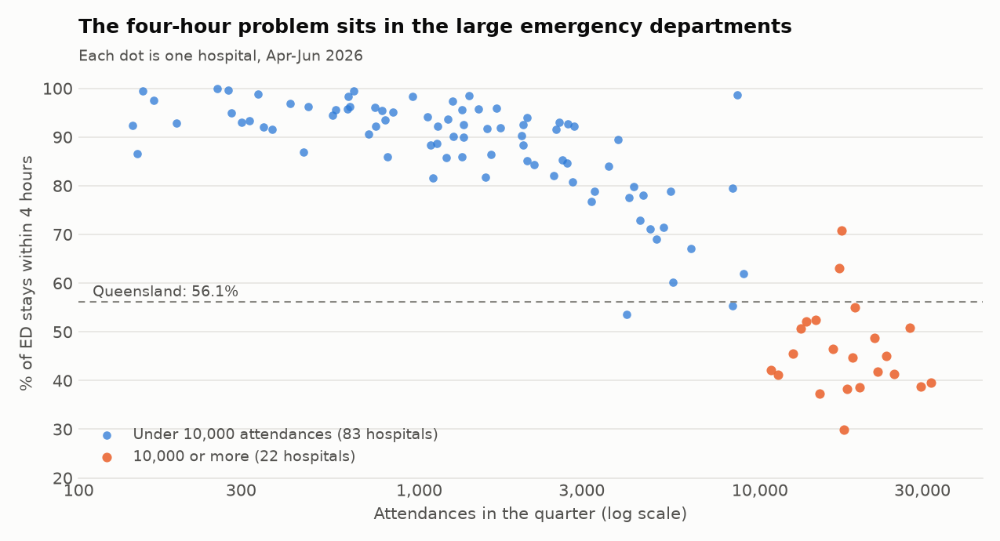

# Queensland emergency department performance

**Status: work in progress.** Part 1 of 5 (source, snapshot and profile) is done.

Where do patients wait in Queensland's public hospital emergency departments (EDs), and which hospitals miss the 4-hour mark? This project treats the state's published ED figures the way an operations analyst would treat a service-level report: check the data first, then find where the delays are, how much is down to the mix of patients, and which hospitals to look at.

## Why it matters

An ED is a queue with a service level attached. Two numbers are watched everywhere: the share of patients **seen within the clinically recommended time** for their triage category, and the share whose **whole ED stay is within 4 hours**. A hospital executive, a health-service planner or a consultant needs to know which of the two is slipping, where, and whether the cause is at the front door (waiting to be seen) or the back door (waiting to leave, usually for a bed).

## Data

| | |
| --- | --- |
| Source | Queensland Health, [Emergency departments - quarterly data](https://www.data.qld.gov.au/dataset/emergency-departments-quarterly-data) |
| Licence | Creative Commons Attribution 4.0 (© State of Queensland, Queensland Health) |
| Coverage | 14 quarters, Jan-Mar 2023 to Apr-Jun 2026; 104 reporting hospitals (105 from Apr-Jun 2026) and a Queensland total |
| Grain | One row per hospital, quarter and triage category (1 to 5, and all categories): 8,826 rows |
| Measures | Attendances, patients seen within the recommended time, median wait, did not wait, left after treatment started, admitted, admissions within 4 hours, ED stays within 4 hours |
| Access | The open data portal's public datastore API. No key or sign-up. |

Triage categories follow the Australasian Triage Scale: 1 is resuscitation (seen immediately) and 5 is non-urgent.

The raw files (1.0 MB) and the tidy snapshot (0.6 MB) are committed, so everything runs offline. `scripts/download_data.py` fetches the same files again and checks each against a pinned SHA-256, so a revision by Queensland Health stops the run instead of silently changing the results.

Not included: the nine earlier quarters (Oct-Dec 2020 to Oct-Dec 2022). The portal holds them only as XLS, XLSX and CSV files in older layouts, not in its datastore.

## Part 1: source, snapshot and profile

Full report: [`results/SOURCE_PROFILE.md`](results/SOURCE_PROFILE.md).

### What the data says so far

Same quarter, three years apart, all triage categories:

| | Apr-Jun 2023 | Apr-Jun 2026 |
| --- | ---: | ---: |
| Attendances | 584,431 | 593,177 |
| Seen within the recommended time | 71% | 74.6% |
| Median wait to treatment | 17 min | 14 min |
| ED stay within 4 hours | 61% | 56.1% |
| Admissions to hospital within 4 hours | 37% | 31.3% |

**1. The delay is at the back door, not the front door.** Patients are being seen a little sooner, yet fewer leave within 4 hours, and the same is true of patients who are admitted. Attendances are up only 1.5% on the same quarter three years earlier, so volume alone does not explain it.


**2. The mix is getting more urgent.** Triage category 2 rose from 16.8% to 20.0% of attendances, while categories 4 and 5 together fell from 40.4% to 36.2%. More urgent patients are admitted more often and stay longer, so part of the fall in the 4-hour figure is mix, not performance. Part 2 separates the two.


**3. The state figure describes 22 hospitals.** In Apr-Jun 2026, 22 of 105 hospitals had 10,000 or more attendances and handled 70.2% of the total. At those hospitals 45.7% of stays were within 4 hours; at the other 83 it was 80.6%. The median hospital is at 86.9%, nowhere near the state's 56.1%.



**So what?** A statewide target tells most hospitals nothing about themselves. The 4-hour problem is concentrated in the large EDs, and across the state what has worsened is getting patients out of the ED, not getting them seen. That points towards beds and discharge flow in the rest of the hospital more than the ED's own front end. It is a hypothesis at this stage: Parts 2 to 4 test it hospital by hospital.

### Is the data trustworthy?

Mostly yes, with quirks the loader handles and the later parts must respect.

- Triage categories 1 to 5 add up to the all-categories row in 1,471 of 1,471 hospital-quarters, and hospitals add up to the Queensland row in 14 of 14 quarters.
- The published "did not wait" and "left after treatment" percentages equal their counts ÷ attendances, to rounding, in every row that has both.
- The published change in attendances matches a recomputed year-on-year change in 6,115 of 6,157 rows. The 42 that do not are in two quarters. The largest gaps are at Nambour in Oct-Dec 2025: for all categories the published change is +5.0%, but the two quarters' own attendance figures give +22.0%.
- Hospital names change between files for 105 of 106 facility codes, column names drift, and missing values are written four ways.
- Percentages are whole numbers in the first 5 quarters and have one decimal place after that.
- In 4 quarters a zero is published as `-`, the same symbol used for "no data".

The profile ends with eight rules for the rest of the project, for example: use facility codes, compare the same quarter a year apart, and never average hospitals to describe the state (the plain average of hospital 4-hour figures is 79.2%, against 56.1% for the state).

## How to run

```bash
python -m venv .venv && source .venv/bin/activate
pip install -r requirements.txt

python scripts/profile_source.py     # Part 1 report, CSVs and charts from the committed snapshot
pytest                               # tests

# optional: rebuild from the source
python scripts/download_data.py      # verifies data/raw/ against pinned hashes; --force fetches again
python scripts/build_snapshot.py     # data/raw/*.json -> data/ed_quarterly.csv
```

## Repository layout

```
edperf/source.py          where the data comes from; pinned hashes; API fetch
edperf/load.py            raw quarterly files -> one tidy table
edperf/profile.py         measures behind the source profile
scripts/                  download, snapshot build, Part 1 report
data/raw/                 14 raw quarterly files as returned by the API
data/ed_quarterly.csv     tidy snapshot: hospital x quarter x triage category
data/facility_names.csv   every spelling each facility code has had
results/                  SOURCE_PROFILE.md, CSVs, charts
tests/                    loader, measures, report regeneration, README figures
```

## Roadmap

1. ~~Source, snapshot and profile~~
2. Mix versus performance: how much of the fall in 4-hour stays is a more urgent mix, and how much is each triage category getting slower
3. Hospital scorecard: peer groups by size, which hospitals are improving or slipping, and by how much
4. Front door versus back door: waits, walk-outs and admitted-patient delays by hospital
5. Star-schema export for Power BI, CI and the final write-up with recommendations

## Limitations

- Aggregated data: quarterly percentages and medians per hospital, with no patient-level records, times of day or diagnoses.
- "Admissions to hospital within 4 hours" is the source's column name. It is read here as the share of admitted patients whose ED stay was within 4 hours; the portal's definitions file could not be downloaded from the machine this was built on.
- The 10,000-attendance line between "large" and other hospitals is a working threshold for Part 1, not an official peer group.
- No official targets are applied yet. Part 3 will add them once they are confirmed from a Queensland Health source.

## Attribution

Contains data from Queensland Health, "Emergency departments - quarterly data", licensed under [CC BY 4.0](https://creativecommons.org/licenses/by/4.0/). The analysis and any errors are mine.
