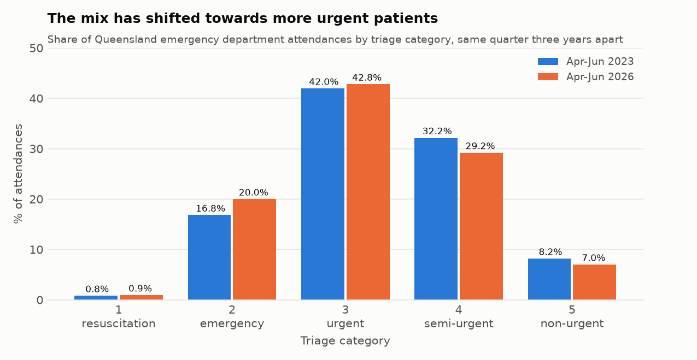
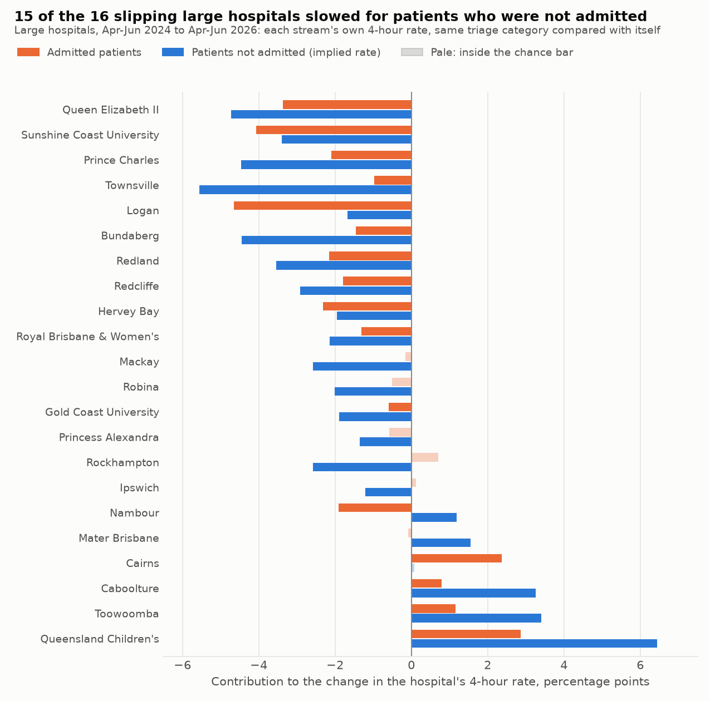
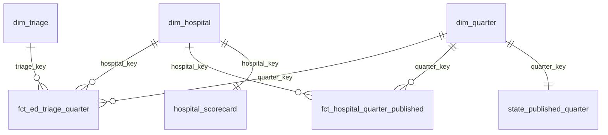

# Queensland emergency department performance

[](https://github.com/nisha1324/qld-emergency-department-performance/actions/workflows/ci.yml)

**Status: work in progress.** The analysis (Parts 1 to 4) and the Power BI model (Part 5) are done. The final write-up with recommendations is still to come.

Where do patients wait in Queensland's public hospital emergency departments (EDs), and which hospitals miss the 4-hour mark? This project treats the state's published ED figures the way an operations analyst would treat a service-level report: check the data first, then find where the delays are, how much is down to the mix of patients, and which hospitals to look at.

## Why it matters

An ED is a queue with a service level attached. Two numbers are watched everywhere: the share of patients **seen within the clinically recommended time** for their triage category, and the share whose **whole ED stay is within 4 hours**. A hospital executive, a health-service planner or a consultant needs to know which of the two is slipping, where, and whether the cause is at the front door (waiting to be seen) or the back door (waiting to leave, usually for a bed).

## Data

| | |
| --- | --- |
| Source | Queensland Health, [Emergency departments - quarterly data](https://www.data.qld.gov.au/dataset/emergency-departments-quarterly-data) |
| Licence | Creative Commons Attribution 4.0 (© State of Queensland, Queensland Health) |
| Coverage | 14 quarters, Jan-Mar 2023 to Apr-Jun 2026; 104 reporting hospitals (105 from Apr-Jun 2026) and a Queensland total |
| Grain | One row per hospital, quarter and triage category (1 to 5, and all categories): 8,826 rows |
| Measures | Attendances, patients seen within the recommended time, median wait, did not wait, left after treatment started, admitted, admissions within 4 hours, ED stays within 4 hours |
| Access | The open data portal's public datastore API. No key or sign-up. |

Triage categories follow the Australasian Triage Scale: 1 is resuscitation (seen immediately) and 5 is non-urgent.

The raw files (1.0 MB) and the tidy snapshot (0.6 MB) are committed, so everything runs offline. `scripts/download_data.py` fetches the same files again and checks each against a pinned SHA-256, so a revision by Queensland Health stops the run instead of silently changing the results.

Not included: the nine earlier quarters (Oct-Dec 2020 to Oct-Dec 2022). The portal holds them only as XLS, XLSX and CSV files in older layouts, not in its datastore.

## Part 1: source, snapshot and profile

Full report: [`results/SOURCE_PROFILE.md`](results/SOURCE_PROFILE.md).

### What the data says so far

Same quarter, three years apart, all triage categories:

| | Apr-Jun 2023 | Apr-Jun 2026 |
| --- | ---: | ---: |
| Attendances | 584,431 | 593,177 |
| Seen within the recommended time | 71% | 74.6% |
| Median wait to treatment | 17 min | 14 min |
| ED stay within 4 hours | 61% | 56.1% |
| Admissions to hospital within 4 hours | 37% | 31.3% |

**1. The delay is at the back door, not the front door.** Patients are being seen a little sooner, yet fewer leave within 4 hours, and the same is true of patients who are admitted. Attendances are up only 1.5% on the same quarter three years earlier, so volume alone does not explain it.


**2. The mix is getting more urgent.** Triage category 2 rose from 16.8% to 20.0% of attendances, while categories 4 and 5 together fell from 40.4% to 36.2%. More urgent patients are admitted more often and stay longer, so part of the fall in the 4-hour figure is mix, not performance. Part 2 separates the two.



**3. The state figure describes 22 hospitals.** In Apr-Jun 2026, 22 of 105 hospitals had 10,000 or more attendances and handled 70.2% of the total. At those hospitals 45.7% of stays were within 4 hours; at the other 83 it was 80.6%. The median hospital is at 86.9%, nowhere near the state's 56.1%.


**So what?** A statewide target tells most hospitals nothing about themselves. The 4-hour problem is concentrated in the large EDs, and across the state what has worsened is getting patients out of the ED, not getting them seen. That points towards beds and discharge flow in the rest of the hospital more than the ED's own front end. It is a hypothesis at this stage: Parts 2 to 4 test it hospital by hospital.

### Is the data trustworthy?

Mostly yes, with quirks the loader handles and the later parts must respect.

- Triage categories 1 to 5 add up to the all-categories row in 1,471 of 1,471 hospital-quarters, and hospitals add up to the Queensland row in 14 of 14 quarters.
- The published "did not wait" and "left after treatment" percentages equal their counts ÷ attendances, to rounding, in every row that has both.
- The published change in attendances matches a recomputed year-on-year change in 6,115 of 6,157 rows. The 42 that do not are in two quarters. The largest gaps are at Nambour in Oct-Dec 2025: for all categories the published change is +5.0%, but the two quarters' own attendance figures give +22.0%.
- Hospital names change between files for 105 of 106 facility codes, column names drift, and missing values are written four ways.
- Percentages are whole numbers in the first 5 quarters and have one decimal place after that.
- In 4 quarters a zero is published as `-`, the same symbol used for "no data".

The profile ends with eight rules for the rest of the project, for example: use facility codes, compare the same quarter a year apart, and never average hospitals to describe the state (the plain average of hospital 4-hour figures is 79.2%, against 56.1% for the state).

## Part 2: mix versus performance

Full report: [`results/MIX_VS_PERFORMANCE.md`](results/MIX_VS_PERFORMANCE.md).

An all-categories rate can fall for two reasons: more patients arrive in the triage categories where stays are longer (**mix**), or patients in the same category get a worse result (**within category**). The change between two quarters splits exactly into the two, with nothing left over. The main comparison is Apr-Jun 2024 to Apr-Jun 2026, the longest same-quarter span published to one decimal place.

| Queensland, Apr-Jun 2024 to Apr-Jun 2026 | Change (points) | Mix | Within category |
| --- | ---: | ---: | ---: |
| ED stay within 4 hours | −3.05 | −1.14 | −1.91 |
| Admitted patients: ED stay within 4 hours | −3.10 | −0.06 | −3.04 |
| Seen within the recommended time | +1.30 | −0.48 | +1.78 |

**1. A more urgent mix is 37% of the fall in 4-hour stays. The other 63% is within category.** The 4-hour rate fell in all five triage categories. Mix lowered the rate in 10 of 10 year-on-year comparisons, and its pull is growing. With the triage mix held at its Jan-Mar 2023 level, the Apr-Jun 2026 figure would be 57.8% instead of 56.1%.


**2. The front door improved by more than the headline shows.** Patients seen on time rose 1.30 points, but the mix pulled that down by 0.48: within categories the gain was 1.78 points. It is not a steady gain; the within-category effect was negative in 3 of 10 year-on-year comparisons.


**3. Patients who are not admitted are leaving later too.** A second split, into admitted and not admitted, does not rely on triage. Admitted patients' 4-hour rate fell from 34.5% to 31.3%. The rate for everyone else is not published, but the published figures imply 68.7% falling to 66.2%, and because those patients are 71% of attendances they account for 1.78 of the 3.0 points, against 0.91 for admitted patients. That corrects Part 1's "back door" reading: the delay is not only among admitted patients.

**4. At the large hospitals the fall is mostly within category; at the other hospitals it is mostly mix.** At the 22 large hospitals the 4-hour rate fell 3.47 points and 83% of that is within category. At the other 82 it fell 1.43 points and 80% of that is mix. Among the 22, 18 fell (9 of them by 5 points or more, led by Sunshine Coast University, 49.8% to 41.4%) and 4 rose (Queensland Children's most, 63.2% to 70.8%).


**A caution on the mix.** Category 2 grew from 17.9% to 20.0% of attendances while a smaller share of its patients were admitted (50.6% to 47.6%). That fits a change in how patients are triaged as well as it fits sicker patients, and quarterly totals cannot tell the two apart. The triage split puts mix at 37% of the fall and the admitted split puts it at 10%.

**So what?** "Patients are sicker" does not explain most of the fall in 4-hour stays, on either split. A health service should report within-category rates next to the headline, because the headline understates the gain in patients seen on time and overstates the loss in 4-hour stays. And it should look at its large hospitals one at a time: over the same two years two lost about 8 points and one gained more than 7, which a state average hides.

## Part 3: hospital scorecard

Full report: [`results/HOSPITAL_SCORECARD.md`](results/HOSPITAL_SCORECARD.md). Every hospital's row: [`results/scorecard_hospitals.csv`](results/scorecard_hospitals.csv).

Each hospital gets two separate verdicts, both against hospitals of a similar size:

- **Level.** Its 4-hour rate recalculated on its peer group's triage mix (the "same-mix rate"), so a hospital is not marked down for having more urgent patients. "Below peers" means the lowest quarter of the group.
- **Trend.** Its within-category change from Apr-Jun 2024 to Apr-Jun 2026, counted as slipping or improving only if it is outside a **chance bar** of ±2.58 standard errors. A rate built from a few hundred patients moves by luck alone, and the bar is how far.

| Peer group (attendances a quarter) | Hospitals | Median same-mix rate | Slipping | No clear change | Improving |
| --- | ---: | ---: | ---: | ---: | ---: |
| Large (10,000 or more) | 22 | 44.3% | 16 | 2 | 4 |
| Medium (2,500 to 9,999) | 26 | 77.5% | 10 | 10 | 5 |
| Small (under 2,500) | 57 | 92.7% | 9 | 45 | 3 |

One medium hospital, Mater Springfield, first reports in Apr-Jun 2026 and has a level but no trend.

**1. 35 of 104 hospitals slipped by more than chance, and 12 improved.** Slipping is the norm among large hospitals: 16 of 22. At those 16 the falls add up to roughly 14,800 more stays over 4 hours in the quarter than their Apr-Jun 2024 category rates would give. Queen Elizabeth II fell the most within category (−8.2 points) and Queensland Children's gained the most (+9.0).


**2. Most of the movement at small hospitals is noise.** On the published figure 74 of 104 hospitals fell, but 45 of 57 small hospitals show no change that chance could not produce. A small hospital's chance bar is about ±2.9 points, against ±1.3 for a large one.


**3. Where a hospital stands and which way it is moving are different questions.** 12 hospitals are below their peers and slipping (5 large, 2 medium, 5 small); the five large ones are Queen Elizabeth II, Hervey Bay, Bundaberg, Royal Brisbane & Women's and Princess Alexandra. Another 8 are in the top quarter of their group and slipping, which a league table of levels would not show. And 3 are in the lowest quarter and improving: Caboolture, Gympie and Kingaroy.


**4. No hospital improved its 4-hour rate while its front door got worse.** Of the 12 improving on 4-hour stays, 11 are also improving on patients seen on time and none is slipping. The reverse does not hold: of the 35 slipping on 4-hour stays, 7 are improving on patients seen on time.

**So what?** A performance report needs two columns per hospital, not one. Comparing everyone with the state figure of 56.1% puts 20 of the 22 large hospitals below it and all 57 small hospitals above it, which says nothing about any of them. Against peers, a health service has a short list to start with (12 below peers and slipping), a second list that a ranking would miss (8 high but slipping), and a reason not to react to most small-hospital swings. The scorecard shows where to look, not why: the chance bar is a floor, and peer medians are not targets.

## Part 4: front door versus back door

Full report: [`results/FRONT_VS_BACK_DOOR.md`](results/FRONT_VS_BACK_DOOR.md). Every hospital's row: [`results/doors_hospitals.csv`](results/doors_hospitals.csv).

Part 3 says which hospitals slipped. This part asks where in the ED the time is lost. Each triage category is cut into two streams, patients who were **admitted** and patients who were **not admitted**, and the change in the 4-hour rate from Apr-Jun 2024 to Apr-Jun 2026 is split four ways, with nothing left over:

| | Change (points) | Triage mix | Admission share | Admitted stream | Not-admitted stream |
| --- | ---: | ---: | ---: | ---: | ---: |
| Queensland | −3.05 | −1.14 | −0.02 | −0.87 | −1.02 |
| Large hospitals | −3.47 | −0.60 | −0.15 | −1.07 | −1.65 |
| Medium hospitals | −1.78 | −1.51 | +0.17 | −0.51 | +0.07 |
| Small hospitals | −1.16 | −0.46 | +0.04 | −0.19 | −0.56 |

The not-admitted stream's 4-hour rate is not published. It is implied by three published figures, and each stream gets the same chance bar as Part 3.

**1. Both streams are slower, so this is not only a bed problem.** Admitted patients are 29.0% of attendances and 45% of the within-category fall: more than their share, but not most of it. Their 4-hour rate went from 34.4% to 31.3%; the implied rate for everyone else went from 68.8% to 66.2%. Part 2 put 1.78 points on patients who were not admitted; with triage held fixed it is 1.02.


**2. At 15 of the 16 slipping large hospitals, patients who were not admitted left later too.** 11 are slipping in both streams, 4 only among patients who were not admitted (Mackay, Rockhampton, Robina and Princess Alexandra) and 1 only among admitted patients (Nambour). The 4 improving large hospitals all gained most among patients who were not admitted. The two streams move together (correlation 0.64 across the 22 large hospitals), which fits crowding slowing everyone as well as it fits two separate problems.



**3. Statewide, the front door is not where the time is lost.** The share of patients who did not wait to be seen fell from 3.34% to 2.87%, though Apr-Jun 2024 was a high point and the medium hospitals' fall came mostly in the latest quarter. The 7 hospitals that slipped on 4-hour stays while improving on patients seen on time all have a shorter median wait, and all 7 are slipping among patients who were not admitted.


**4. Some front-door figures look like a change in recording.** In Apr-Jun 2024, 36 hospitals published a median wait of 0 or 1 minute. At 9 of them it had risen to 5 minutes or more by Apr-Jun 2026, and 6 of the 26 hospitals that Part 3 marks as slipping on patients seen on time are in that group. Their slip may be measurement, not service; the data cannot confirm either.

**So what?** A hospital executive deciding where to spend should not assume the answer is inpatient beds. Of the 35 hospitals slipping on 4-hour stays, 32 are slipping among patients who were not admitted and 23 among admitted patients. The stream says who to talk to first: bed managers where only the admitted stream slips, the ED's own tests, reviews and discharge decisions where only the not-admitted stream slips, and crowding where both do. It says where the time is lost, not why.

## Part 5: a model for Power BI

Build guide: [`powerbi/POWERBI_GUIDE.md`](powerbi/POWERBI_GUIDE.md). Check values: [`powerbi/CHECKS.md`](powerbi/CHECKS.md). The SQL: [`sql/star_schema.sql`](sql/star_schema.sql).

Parts 1 to 4 are fixed reports. A hospital executive will want to pick their own hospital, peer group or triage category, and that is a job for a BI tool. The catch is that the source publishes **percentages**, and a BI tool that averages percentages gets the wrong answer: the plain average of hospital 4-hour figures is 79.2% for a state at 56.1%.

So the model is a star schema, built in DuckDB SQL, whose fact table turns each published percentage back into a head count (attendances × rate). Every rate in the report is then a sum of counts divided by a sum of attendances, and it stays right under any filter.



| Table | Rows | What it holds |
| --- | ---: | --- |
| `fct_ed_triage_quarter` | 7,285 | Hospital × quarter × triage category: attendances, walk-outs, and head counts for seen on time, 4-hour stays, admissions and the two streams |
| `fct_hospital_quarter_published` | 1,457 | The published all-categories row per hospital and quarter (the median wait lives here: a median cannot be added up) |
| `dim_hospital`, `dim_quarter`, `dim_triage` | 105, 14, 5 | Peer group; financial year and the two comparison quarters; triage names and recommended waits |
| `hospital_scorecard` | 105 | Level, trend and stream verdicts from Parts 3 and 4, carried as columns, not recalculated |
| `state_published_quarter` | 14 | The Queensland row as published, to show next to the model's figure |

The pack also has 27 DAX measures and 8 check queries with the values they should return.

**1. The model rebuilds the published figures.** Adding a hospital's five categories back up gives its published 4-hour figure to within 0.1 points in all 937 hospital-quarters published to one decimal place, and to within 1.0 in all 520 published as whole numbers. For the state, the model gives 56.12% in Apr-Jun 2026 against the published 56.1%.

**2. In four quarters a blank is a zero, and treating it as "no data" gives the wrong admitted share.** Apr-Jun 2023 to Jan-Mar 2024 publish a zero as `-`. In 83 hospital-quarters a category's admitted share is blank while the hospital's total is published. Reading the blank as zero rebuilds the published total in 83 of 83; dropping the row does so in 62 of 83. At Cunnamulla in Oct-Dec 2023 the model gives 7.85% (published: 8%); dropping the blank rows would give 11.37%.

**3. The verdicts travel with the model, with their caveats.** The scorecard's level and trend, the four effects and the stream verdicts are columns, so the report counts them (16 of 22 large hospitals slipping, 12 hospitals below peers and slipping) and does not redo a chance test in DAX. The not-admitted rate is labelled "implied" in its measure name, and the 9 hospitals whose median wait stepped up carry a `wait_step` flag.

**So what?** The analysis can now be handed to someone who does not run Python. A health-service analyst can open the report, filter to their own hospital and get the same numbers as this README, and the two easiest mistakes with this data (averaging percentages, and reading a `-` as missing) are designed out of the model instead of being left to each report author.

**Not done yet:** the DAX has not been run in Power BI, which needs Windows. Its logic is mirrored in SQL and tested here; the 8 check queries are how the first build confirms it.

## How to run

```bash
python -m venv .venv && source .venv/bin/activate
pip install -r requirements.txt

python scripts/profile_source.py     # Part 1 report, CSVs and charts from the committed snapshot
python scripts/mix_report.py         # Part 2 report, CSVs and charts
python scripts/scorecard_report.py   # Part 3 report, CSVs and charts
python scripts/doors_report.py       # Part 4 report, CSVs and charts
python scripts/export_powerbi.py     # Part 5: star schema -> powerbi/data/*.parquet
python scripts/powerbi_checks.py     # Part 5: powerbi/CHECKS.md
pytest                               # tests

# optional: rebuild from the source
python scripts/download_data.py      # verifies data/raw/ against pinned hashes; --force fetches again
python scripts/build_snapshot.py     # data/raw/*.json -> data/ed_quarterly.csv
```

## Repository layout

```
edperf/source.py          where the data comes from; pinned hashes; API fetch
edperf/load.py            raw quarterly files -> one tidy table
edperf/profile.py         measures behind the source profile
edperf/mix.py             mix versus within-category split
edperf/scorecard.py       peer groups, same-mix rates, chance bars, level and trend verdicts
edperf/doors.py           admitted and not-admitted streams, four-way split, walk-outs
edperf/star.py            builds the star schema in DuckDB, checks it against the snapshot, writes Parquet
sql/star_schema.sql       the star schema: 2 facts, 3 dimensions, scorecard, published state row
powerbi/                  Parquet files, MANIFEST.json, measures.dax, CHECKS.md, POWERBI_GUIDE.md
scripts/                  download, snapshot build, Part 1 to Part 4 reports, Power BI export and check values
data/raw/                 14 raw quarterly files as returned by the API
data/ed_quarterly.csv     tidy snapshot: hospital x quarter x triage category
data/facility_names.csv   every spelling each facility code has had
results/                  SOURCE_PROFILE.md, MIX_VS_PERFORMANCE.md, HOSPITAL_SCORECARD.md, FRONT_VS_BACK_DOOR.md, CSVs, charts
tests/                    loader, measures, the splits, the scorecard and the star schema on hand-made numbers, report regeneration, README figures
```

## Roadmap

1. ~~Source, snapshot and profile~~
2. ~~Mix versus performance: how much of the fall in 4-hour stays is a more urgent mix, and how much is each triage category getting slower~~
3. ~~Hospital scorecard: peer groups by size, which hospitals are improving or slipping within category, and by how much~~
4. ~~Front door versus back door: waits, walk-outs and admitted-patient delays by hospital~~
5. ~~Star-schema export for Power BI: DuckDB SQL, Parquet, DAX measures, check values and a build guide~~
6. Final write-up with recommendations

## Limitations

- Aggregated data: quarterly percentages and medians per hospital, with no patient-level records, times of day or diagnoses.
- "Admissions to hospital within 4 hours" is the source's column name. It is read here as the share of admitted patients whose ED stay was within 4 hours; the portal's definitions file could not be downloaded from the machine this was built on.
- Triage category is the only measure of how sick patients are. A change in triage practice looks the same as a change in patients, so the mix effect in Part 2 is an estimate, not a fact about patients.
- The 4-hour rate of patients who were not admitted is implied by three published figures, not published itself. Part 4's chance bar for that stream does not include the rounding of those figures; the report shows which verdicts would not survive the worst case.
- Part 4's streams say where the time is lost, not why. Admitted patients waiting in the ED for a bed can slow everyone else, and quarterly totals cannot separate that from a separate problem among patients who go home.
- A median wait of 0 or 1 minute, published by about a third of hospitals, may reflect how the start of treatment is recorded. Front-door changes at hospitals where it jumped are flagged, not explained.
- The Power BI model reads a blank percentage as zero in the four quarters that publish a zero as `-`. The evidence is for the admitted share (Part 5). The same reading is applied to the other rates in those quarters, including 13 category rows (24 patients) with a blank 4-hour rate.
- The DAX measures have not been run in Power BI. The Power BI model's rates come from rounded category percentages, so they match the published figures to rounding, not exactly.
- "Seen within the recommended time" does not rebuild exactly from its five categories (the rebuilt figure is about 0.3 points higher), so Part 2 uses its changes, not its levels.
- The three size groups (cut at 2,500 and 10,000 attendances a quarter) are working groups for this analysis, not Queensland Health's official peer groups. A hospital near a cut-off could be scored differently in the next group.
- No official targets are applied. Queensland Health's targets could not be confirmed from a primary source on the machine this was built on, so Part 3 scores hospitals against the median of their peer group, which describes what similar hospitals do and is not a standard of care.
- The chance bar in Part 3 treats patients as independent. Stays in a crowded ED are not, so the true noise is probably larger and a flag means "worth a look", not proof. The bar is narrowest, and least reliable, at the smallest hospitals.
- Part 3's trend compares two quarters two years apart. It does not say what happened in between, beyond the one-year split in the report.

## Attribution

Contains data from Queensland Health, "Emergency departments - quarterly data", licensed under [CC BY 4.0](https://creativecommons.org/licenses/by/4.0/). The analysis and any errors are mine.
