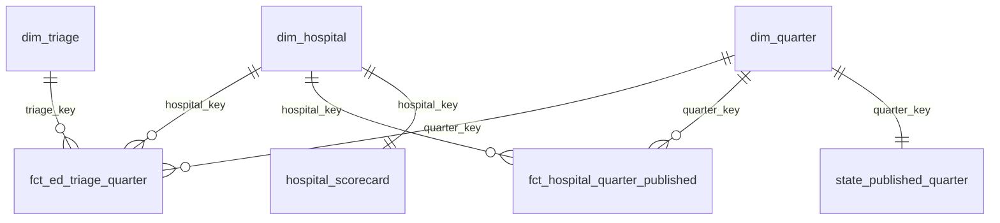

# Power BI build guide

How to turn the analysis into a Power BI report on Windows, with the same numbers as the README. Allow about an hour for the first build.

Everything Power BI needs is in this folder:

| File | What it is |
|---|---|
| [`data/*.parquet`](data) | The star schema: 2 fact tables, 3 dimensions, the hospital scorecard and the published state row (under 0.5 MB). Built by [`sql/star_schema.sql`](../sql/star_schema.sql) in DuckDB and written by `scripts/export_powerbi.py`, which reads each file back and checks it against the table it came from. |
| [`data/MANIFEST.json`](data/MANIFEST.json) | Row count, column types, null counts and column totals for every file. |
| [`measures.dax`](measures.dax) | Every measure, plus 8 check queries. Paste it into DAX query view. |
| [`CHECKS.md`](CHECKS.md) | What the check queries should return. Tests tie every value to the Python analysis. |

> **Status:** the DAX has not been run inside Power BI yet, because Power BI Desktop only runs on Windows and this project was built on Linux. What is tested here: the measures use only tables and columns that exist in the export, every measure a query uses is defined, and each check value (computed in SQL with the same logic) matches Parts 1 to 4. The check queries in step 5 confirm the DAX on the first build.

## Why a star schema for this data

The source publishes **percentages**: 56.1% of stays within 4 hours, 29.0% admitted. A report tool cannot add percentages up. Averaging the 4-hour figure across hospitals gives 79.2% for a state whose real figure is 56.1%, because 57 small hospitals count the same as 22 large ones.

So the fact table turns each published percentage back into a **head count** (attendances × rate), and each count has a **base** column next to it (the attendances of the rows where the rate is known). Every rate in the report is then `sum of count ÷ sum of base`, and it stays right for any slicer: one hospital, a peer group, a triage category or the state.

## 1. Before you start

- Install **Power BI Desktop** (free, from the Microsoft Store).
- Get the repo: `git clone https://github.com/nisha1324/qld-emergency-department-performance`, or download the ZIP from GitHub. Python is not needed: the Parquet files are committed.
- In Power BI: **File → Options and settings → Options → Current file → Data load**, untick **Auto date/time** (this model has its own quarter table) and untick **Autodetect new relationships after data is loaded** (step 3 sets them explicitly).

## 2. Load the tables (Power Query)

1. **Home → Transform data** opens Power Query.
2. **Home → Manage parameters → New parameter:** name `DataFolder`, type **Text**, current value the full path to `powerbi\data\` with a trailing backslash, e.g. `C:\Users\you\qld-emergency-department-performance\powerbi\data\`.
3. For each table below: **Home → New source → Blank query**, open **Advanced editor**, paste, change the file name, and rename the query to the name in the table.

```powerquery
let
    Source = Parquet.Document(File.Contents(DataFolder & "fct_ed_triage_quarter.parquet"))
in
    Source
```

| Query name | File | Rows | One row per… |
|---|---|---|---|
| `fct_ed_triage_quarter` | `fct_ed_triage_quarter.parquet` | 7,285 | hospital × quarter × triage category (1 to 5) |
| `fct_hospital_quarter_published` | `fct_hospital_quarter_published.parquet` | 1,457 | hospital × quarter, all categories, as published (median wait lives here) |
| `dim_hospital` | `dim_hospital.parquet` | 105 | hospital, with its size peer group |
| `dim_quarter` | `dim_quarter.parquet` | 14 | quarter, with financial year and the two comparison quarters |
| `dim_triage` | `dim_triage.parquet` | 5 | triage category, with its recommended waiting time |
| `hospital_scorecard` | `hospital_scorecard.parquet` | 105 | hospital: level, trend and stream verdicts from Parts 3 and 4 |
| `state_published_quarter` | `state_published_quarter.parquet` | 14 | quarter: the Queensland row as published |

Keep the table and column names as they are: the DAX uses them.

4. Check the types Power Query picked up: text → **Text**, keys and counts → **Whole number**, `quarter_start` → **Date**, true/false flags → **True/False**, and every estimated count (`stays_within_4h`, `admitted`, the `stream_…` columns and their bases) → **Decimal number**. Do not change the estimated counts to Whole number: they are attendances × a published rate, so most are not whole, and rounding them would move every rate.
5. **Close & Apply.**

## 3. Relationships (Model view)

Create exactly these seven:

| From | To | Cardinality | Cross-filter |
|---|---|---|---|
| `fct_ed_triage_quarter[hospital_key]` | `dim_hospital[hospital_key]` | Many to one | Single |
| `fct_ed_triage_quarter[quarter_key]` | `dim_quarter[quarter_key]` | Many to one | Single |
| `fct_ed_triage_quarter[triage_key]` | `dim_triage[triage_key]` | Many to one | Single |
| `fct_hospital_quarter_published[hospital_key]` | `dim_hospital[hospital_key]` | Many to one | Single |
| `fct_hospital_quarter_published[quarter_key]` | `dim_quarter[quarter_key]` | Many to one | Single |
| `hospital_scorecard[hospital_key]` | `dim_hospital[hospital_key]` | One to one | Both |
| `state_published_quarter[quarter_key]` | `dim_quarter[quarter_key]` | One to one | Both |



**Why is the scorecard its own table and not more columns on `dim_hospital`?** The hospital's name and size group describe the hospital. The scorecard describes one comparison (Apr-Jun 2024 to Apr-Jun 2026) and will be replaced when a new quarter is published. Keeping it apart means a refresh swaps one file. The one-to-one relationship lets a slicer on `hospital_scorecard[trend]` filter every other visual.

**Why is there no relationship between the two fact tables?** They have different grains. Each joins the dimensions, and the dimensions filter both.

**Why not "Mark as date table"?** Power BI's date table needs one row per day; `dim_quarter` has one row per quarter. No time-intelligence functions are used: the year-earlier measures step back four rows on `quarter_index`.

Sort the text columns (Column tools → **Sort by column**):

| Column | Sort by |
|---|---|
| `dim_quarter[quarter_label]` | `quarter_key` |
| `dim_quarter[quarter_name]` | `quarter_of_year` |
| `dim_triage[triage_label]` | `triage_key` |
| `dim_hospital[peer_group_label]` | `peer_group_sort` |
| `hospital_scorecard[trend]` | `trend_sort` |

Then hide what report users should not drag onto a visual: every `*_key` and `*_id` column, every numeric column of `fct_ed_triage_quarter` (the measures replace them), and above all the `*_published` percentage columns. A published percentage dragged onto a visual is summed or averaged, which is the mistake this model exists to prevent.

## 4. Measures (DAX query view)

1. Open **DAX query view** (its icon is in the bar on the left, after Report, Table and Model view).
2. Paste all of [`measures.dax`](measures.dax) and click **Run**. The check queries run with the measures defined in the query only.
3. Click **Update model with changes**: it adds every measure to its table.
4. In Model view, set formats: the `%` measures → **Percentage, 1 decimal place** (2 while you check against `CHECKS.md`); the `(points)` measures → **Decimal number, 1 decimal place**; counts → **Whole number with thousands separator**.

If your version has no DAX query view, add each one with **New measure** and paste the part after `MEASURE table[`, i.e. `Name = expression`.

The measures follow the same rules as the Python analysis:

| Rule | Why it matters | In the DAX |
|---|---|---|
| Rates are ratios of sums | An average of hospital percentages gives 79.2% for a state at 56.1% | `DIVIDE ( SUM ( count ), SUM ( base ) )`, never `AVERAGE` of a rate |
| A count is divided by its own base | A row with no published rate should leave both sides, not count as zero | `stays_4h_base`, `admitted_base`, `seen_on_time_base`, `stream_admitted`, `stream_not_admitted` |
| A blank is a zero in four quarters | Apr-Jun 2023 to Jan-Mar 2024 publish a zero as `-`; dropping those rows overstates the admitted share (check 7) | Handled in `sql/star_schema.sql`; `dim_quarter[zero_published_as_dash]` marks the quarters |
| The not-admitted rate is implied | It is not published; three published figures imply it | The measure is named `Not Admitted 4-hour Stay % (implied)`. Keep the label on visuals |
| Medians are not added up | A median of medians is not the median | `Median Wait (minutes, published)` is blank unless one hospital and one quarter are in context |
| Verdicts are not recalculated | Level and trend rest on a chance test and a fixed two-quarter comparison | `hospital_scorecard` columns, counted by the `Hospitals …` measures |
| "Seen on time" is for changes | Rebuilt from categories it runs about 0.3 points above the published figure | The measure is named `Seen On Time % (rebuilt)` |

In the current data every row with attendances has a usable rate once the blank-as-zero rule is applied, so each base equals attendances. The bases are there so that a future quarter with a real gap does not silently pull a rate down.

## 5. Check the numbers

Run the 8 `EVALUATE` queries at the end of `measures.dax` (still in DAX query view; pick a result from the drop-down) and compare with [`CHECKS.md`](CHECKS.md). They cover the state by quarter against the published figure, the peer groups and their two streams, the triage categories, the year-on-year change, the scorecard counts, the five large hospitals that are below peers and slipping, the blank-as-zero quarters and the grand totals.

If something does not match:

- **Everything is off:** a relationship is missing or points the wrong way. Model view should show exactly the seven in step 3.
- **Check 5 or 6 is off but 1 to 4 are right:** the `hospital_scorecard` relationship is missing or is not cross-filtering in both directions.
- **Check 1's `published` column is blank:** the `state_published_quarter` relationship is missing.
- **Rates are slightly off:** an estimated count column was changed to Whole number.
- **Check 4 is blank:** more than one quarter is in context, or `quarter_index` was changed.

## 6. Report pages

Four pages, one per part of the analysis.

| Page | Question | Visuals |
|---|---|---|
| **1. State trend** | Is the 4-hour figure falling, and is it the patient mix? | Cards for the latest quarter: `Attendances`, `4-hour Stay %`, `4-hour Stay Change On Year (points)`. Line chart: `quarter_label` by `4-hour Stay %` with `Queensland 4-hour Stay % (published)` beside it. Stacked column: `quarter_label` by `Triage Share %`, legend `triage_label`. Table: `triage_label` with `4-hour Stay % Start`, `4-hour Stay % Latest` and the change (the rate fell in all five categories). |
| **2. Hospital scorecard** | Which hospitals are slipping, against hospitals their own size? | Slicer: `peer_group_label`. Scatter: `hospital_scorecard[same_mix_vs_peer_median]` on x, `within_category_effect` on y, one dot per `hospital_name`, colour by `trend`. Table: `hospital_name`, `level`, `trend`, `within_category_effect`, `chance_bar`, `4-hour Stay % Latest`, sorted worst first. Cards: `Hospitals Slipping`, `Hospitals Improving`, `Hospitals Below Peers And Slipping`. |
| **3. Front door or back door** | Where in the ED is the time lost? | Slicer: `hospital_name` (or `peer_group_label`). Clustered column at the two comparison quarters: `Admitted 4-hour Stay %` and `Not Admitted 4-hour Stay % (implied)` next to `4-hour Stay %`. Table: `hospital_name`, `slipping_pattern`, `admitted_stream_effect`, `not_admitted_stream_effect`, `triage_mix_effect`, `admission_share_effect`. Line: `Did Not Wait %` by `quarter_label`. |
| **4. One hospital** | What does this hospital's record look like? | Single-select slicer: `hospital_name`. Lines by `quarter_label`: `4-hour Stay %`, `Seen On Time % (rebuilt)`, `Median Wait (minutes, published)`. Table by `triage_label`: `Attendances`, `Triage Share %`, `4-hour Stay %`, `Admitted %`. Card row from `hospital_scorecard`: `level`, `trend`, `slipping_pattern`, `wait_step`. |

Add a text box on each page with the caveats that travel with the numbers:

- Page 1: the first five quarters were published as whole-number percentages (`dim_quarter[whole_number_rates]`), so small moves before Apr-Jun 2024 are inside the rounding.
- Page 2: peer groups are working groups by size, not Queensland Health's official peer groups; "below peers" is the lowest quarter of the group, not a failed target; the chance bar is a floor.
- Page 3: the not-admitted rate is implied, not published; the streams show where time is lost, not why.
- Page 4: where `wait_step` is true, the median wait went from 0 to 1 minutes to 5 or more, which may be a change in recording.

## 7. Save and share

- Save as `powerbi/qld_ed_performance.pbix`. (If the Power BI Project preview feature is turned on, saving as `.pbip` stores the model as text files, which show up better in git diffs.)
- Export a screenshot of each page to `powerbi/screenshots/` (PNG) so the README can show the report without Power BI.

## Refreshing with a newer quarter

First add the new quarter's resource id to `RESOURCES` in `edperf/source.py`, run `python scripts/download_data.py --update-pins` and paste the hash it prints next to the id. Then:

```bash
python scripts/download_data.py           # verifies every raw file against its pinned hash
python scripts/build_snapshot.py
python scripts/profile_source.py && python scripts/mix_report.py
python scripts/scorecard_report.py && python scripts/doors_report.py
python scripts/export_powerbi.py          # Parquet + manifest, read back and checked
python scripts/powerbi_checks.py          # new CHECKS.md
```

Then **Home → Refresh** in Power BI. The comparison quarters move by themselves: `comparison_role` in `dim_quarter` and the scorecard are rebuilt from the data.
