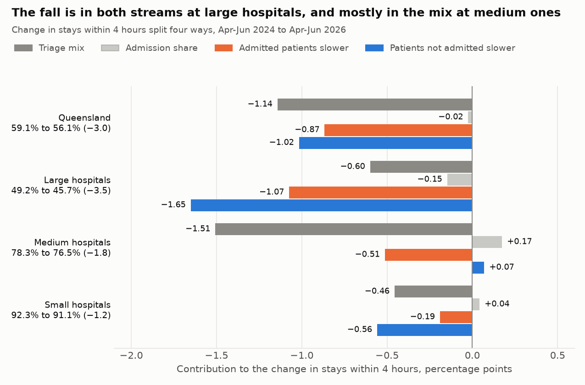
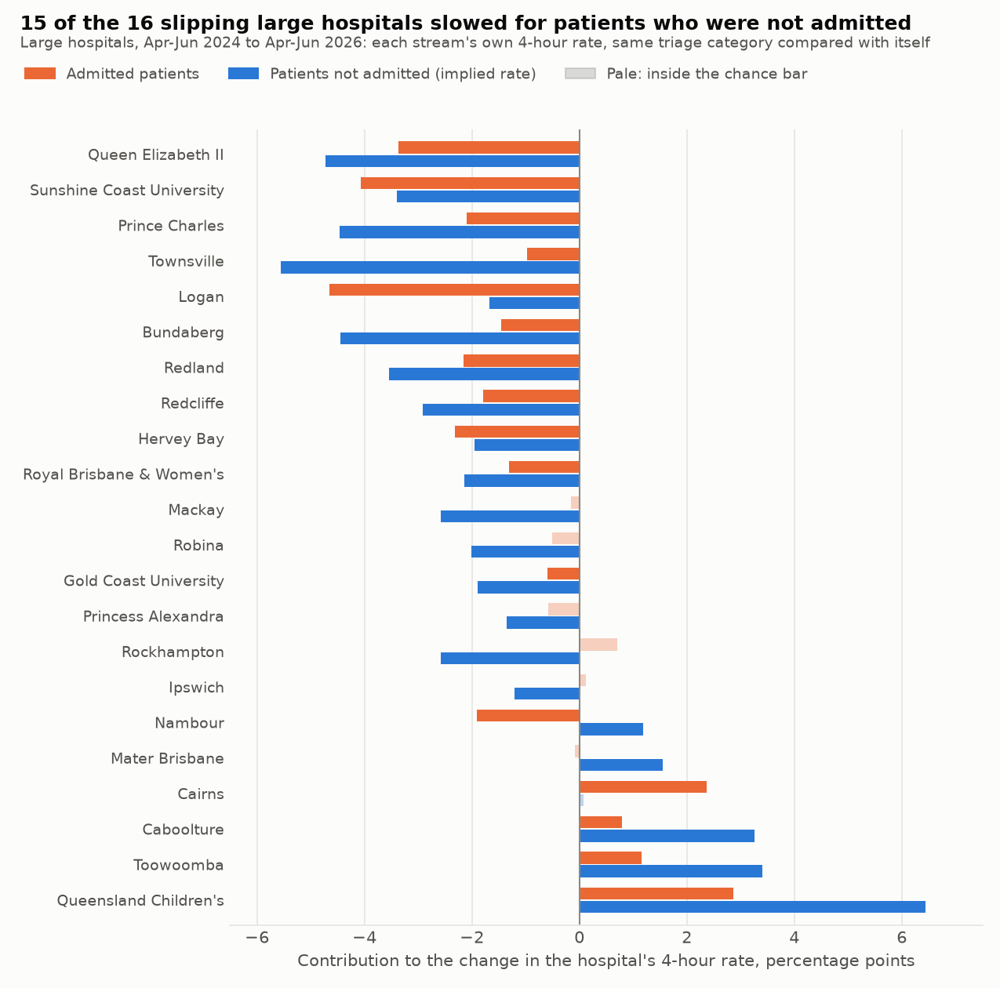
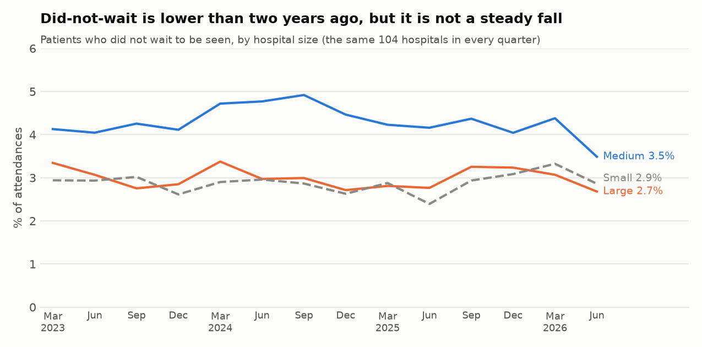

# Front door versus back door: where in the ED did the 4-hour rate fall?

*Generated by `scripts/doors_report.py` from the snapshot in `data/`. Do not edit by hand.*

Part 3 says which hospitals' rate of emergency department (ED) stays within 4 hours slipped. This part asks where in the ED the slip sits: at the **front door** (waiting to be seen), among patients who leave for a **hospital bed**, or among patients who are **not admitted** and mostly go home. The three point to different fixes: triage and first assessment, inpatient beds and discharge, or the ED's own tests, decisions and discharges.

## 1. Method

- **Two streams.** Every triage category is cut into patients who were admitted and patients who were not. The admitted stream's 4-hour rate is published. The not-admitted stream's rate is not: it is the rate implied by the published stay rate, admitted share and admitted 4-hour rate, and is labelled *implied* throughout.
- **A four-way split.** The change in a hospital's 4-hour rate from Apr-Jun 2024 to Apr-Jun 2026 is split exactly into: **triage mix** (Part 2's mix effect, unchanged), **admission share** (within a triage category, a different share of patients was admitted), the **admitted stream** (admitted patients' own rate moved) and the **not-admitted stream** (everyone else's own rate moved). The last three add up to Part 2's within-category effect. Stream effects are in points of the hospital's all-patients rate, so the two can be compared directly.
- **Chance bar.** As in Part 3: a stream is **slipping** or **improving** only if its effect is outside ±2.58 standard errors, treating patients as independent. The bar is a floor, not a full margin of error. Figures in **bold** are outside it.
- **Rounding.** The implied rate also carries the rounding of three published percentages, which the chance bar does not include. If every one were off by 0.05 points in the worst direction, a large hospital's not-admitted effect would move by 0.16 points at the median (at most 0.18). Adding that worst case to the bar, 47 of the 50 not-admitted verdicts stand; the 3 that would not are Gladstone, Miles and Eidsvold MPHS. 37 of the 40 admitted verdicts stand (not Mareeba, Longreach and Clermont MPHS).
- **Front door.** Patients seen within the recommended time (Part 3's verdict), the median wait, and patients who **did not wait** to be seen, as a share of attendances. Did-not-wait is scored like the 4-hour rate: its within-category change against a chance bar, where *rising* is the bad direction.
- **Coverage.** The 104 hospitals that reported in both quarters, in Part 3's three size groups. Mater Springfield, which first reports in Apr-Jun 2026, is left out.
- **Check.** For every hospital the ten cells (five triage categories, two streams) add back to the same 4-hour rate as the five categories do, and the four effects add up to the change with nothing left over.

## 2. Queensland: both streams are slower

|  | Within 4 h, Apr-Jun 2024 | Within 4 h, Apr-Jun 2026 | Change (points) | Triage mix | Admission share | Admitted stream | Not-admitted stream |
| --- | ---: | ---: | ---: | ---: | ---: | ---: | ---: |
| Queensland | 59.1% | 56.1% | −3.05 | −1.14 | −0.02 | −0.87 | −1.02 |
| Large hospitals | 49.2% | 45.7% | −3.47 | −0.60 | −0.15 | −1.07 | −1.65 |
| Medium hospitals | 78.3% | 76.5% | −1.78 | −1.51 | +0.17 | −0.51 | +0.07 |
| Small hospitals | 92.3% | 91.1% | −1.16 | −0.46 | +0.04 | −0.19 | −0.56 |

- Statewide the rate fell 3.05 points. Triage mix is 1.14 of that (Part 2). Of the remaining 1.91, admitted patients leaving later account for 0.87 points (45%) and patients who were not admitted for 1.02 (53%). The admission share within categories barely moved (−0.02).
- **Admitted patients carry more than their share of the fall, but not most of it.** They are 29.0% of attendances and 45% of the within-category fall. Their own 4-hour rate went from 34.4% to 31.3%; the implied rate for everyone else went from 68.8% to 66.2%.
- This refines Part 2, which split the same fall into admitted and not admitted without holding triage fixed and put 1.78 points on patients who were not admitted and 0.91 on admitted patients. With triage held fixed the not-admitted part is 1.02 points: the rest of the earlier figure was a more urgent triage mix among patients who were not admitted.
- **The size groups differ.** At the large hospitals both streams fell and the not-admitted stream fell more (−1.65 against −1.07). At the medium hospitals, pooled, the not-admitted stream did not move (+0.07; section 4 shows hospitals moving both ways); what fell there is triage mix (−1.51) and the admitted stream (−0.51). At the small hospitals the effects are small (−0.19 and −0.56).

## 3. Large hospitals

| Hospital | 4-hour trend (Part 3) | Change (points) | Triage mix | Admission share | Admitted stream | Not-admitted stream | Slipping in | Admitted: within 4 h | Not admitted: within 4 h (implied) |
| --- | ---: | ---: | ---: | ---: | ---: | ---: | ---: | ---: | ---: |
| Queen Elizabeth II | slipping | −8.0 | +0.2 | −0.1 | **−3.4** | **−4.7** | both streams | 34.7% to 26.4% | 52.8% to 45.1% |
| Sunshine Coast University | slipping | −8.3 | −1.0 | +0.2 | **−4.1** | **−3.4** | both streams | 35.3% to 24.9% | 59.4% to 52.6% |
| Townsville | slipping | −6.8 | 0.0 | −0.2 | **−1.0** | **−5.6** | both streams | 23.3% to 19.9% | 63.4% to 55.5% |
| Prince Charles | slipping | −7.4 | −0.9 | 0.0 | **−2.1** | **−4.5** | both streams | 38.7% to 32.6% | 68.8% to 60.8% |
| Logan | slipping | −7.5 | −1.1 | −0.1 | **−4.7** | **−1.7** | both streams | 42.9% to 32.0% | 49.1% to 43.8% |
| Redland | slipping | −4.3 | +1.2 | +0.2 | **−2.2** | **−3.5** | both streams | 40.9% to 34.8% | 66.2% to 61.7% |
| Hervey Bay | slipping | −7.0 | −1.7 | −1.0 | **−2.3** | **−2.0** | both streams | 27.9% to 22.3% | 60.6% to 55.8% |
| Bundaberg | slipping | −5.4 | −0.5 | +1.0 | **−1.5** | **−4.4** | both streams | 21.6% to 16.4% | 56.8% to 49.8% |
| Redcliffe | slipping | −5.4 | −0.5 | −0.2 | **−1.8** | **−2.9** | both streams | 35.0% to 30.5% | 59.0% to 53.8% |
| Mackay | slipping | −5.6 | −1.5 | −1.3 | −0.1 | **−2.6** | not admitted only | 25.1% to 24.6% | 73.2% to 68.2% |
| Rockhampton | slipping | −3.9 | 0.0 | −2.0 | +0.7 | **−2.6** | not admitted only | 21.6% to 24.1% | 66.1% to 62.6% |
| Royal Brisbane & Women's | slipping | −3.0 | +0.2 | +0.2 | **−1.3** | **−2.1** | both streams | 26.8% to 23.2% | 54.8% to 51.6% |
| Gold Coast University | slipping | −3.0 | −0.7 | +0.2 | **−0.6** | **−1.9** | both streams | 21.4% to 18.9% | 51.7% to 48.2% |
| Robina | slipping | −2.2 | 0.0 | +0.3 | −0.5 | **−2.0** | not admitted only | 42.2% to 40.4% | 64.4% to 61.4% |
| Nambour | slipping | −3.0 | −0.8 | −1.5 | **−1.9** | **+1.2** | admitted only | 38.2% to 30.0% | 73.2% to 74.6% |
| Princess Alexandra | slipping | −2.1 | −0.3 | +0.1 | −0.6 | **−1.4** | not admitted only | 27.9% to 26.7% | 36.1% to 32.8% |
| Ipswich | no clear change | −1.4 | −0.1 | −0.1 | +0.1 | **−1.2** | not admitted only | 27.4% to 27.7% | 49.5% to 47.1% |
| Cairns | no clear change | −0.3 | −1.3 | −1.5 | **+2.4** | +0.1 | neither stream | 26.3% to 32.5% | 61.0% to 60.2% |
| Mater Brisbane | improving | +1.0 | −0.7 | +0.1 | −0.1 | **+1.6** | neither stream | 27.4% to 27.1% | 53.9% to 55.5% |
| Caboolture | improving | +3.9 | +0.3 | −0.4 | **+0.8** | **+3.3** | neither stream | 17.4% to 19.8% | 42.6% to 47.9% |
| Toowoomba | improving | +3.5 | −0.6 | −0.5 | **+1.2** | **+3.4** | neither stream | 26.0% to 29.0% | 51.4% to 56.4% |
| Queensland Children's | improving | +7.6 | −1.4 | −0.3 | **+2.9** | **+6.4** | neither stream | 38.7% to 48.4% | 71.9% to 79.8% |

- **Of the 16 slipping large hospitals, 11 are slipping in both streams, 4 only among patients who were not admitted (Mackay, Rockhampton, Robina and Princess Alexandra) and 1 only among admitted patients (Nambour).** So the not-admitted stream is slipping at 15 of the 16.
- At 12 of the 16 the not-admitted stream is the larger part of the fall. The largest admitted falls are at Logan, Sunshine Coast University and Queen Elizabeth II; the largest not-admitted falls are at Townsville, Queen Elizabeth II and Prince Charles.
- **The 4 improving large hospitals all improved among patients who were not admitted**, and at each of them that stream is the larger part of the gain. 3 also improved among admitted patients.
- **The two streams move together** (correlation 0.64 across the 22 large hospitals). That fits one cause slowing both, such as admitted patients waiting in ED cubicles for a bed while new patients queue behind them, as well as it fits two separate problems. Quarterly totals cannot tell these apart.

## 4. Medium hospitals

| Hospital | 4-hour trend (Part 3) | Change (points) | Triage mix | Admission share | Admitted stream | Not-admitted stream | Slipping in | Admitted: within 4 h | Not admitted: within 4 h (implied) |
| --- | ---: | ---: | ---: | ---: | ---: | ---: | ---: | ---: | ---: |
| Dalby | slipping | −9.1 | +0.2 | 0.0 | **−4.9** | **−4.4** | both streams | 95.1% to 72.2% | 92.5% to 87.0% |
| Proserpine | slipping | −11.0 | −4.6 | +1.8 | **−2.1** | **−6.1** | both streams | 41.7% to 17.2% | 88.6% to 77.8% |
| Gatton | slipping | −6.4 | −0.1 | −0.1 | −0.6 | **−5.6** | not admitted only | 77.3% to 62.7% | 92.2% to 86.3% |
| Atherton | slipping | −6.7 | −1.1 | +0.6 | **−2.6** | **−3.6** | both streams | 38.3% to 22.5% | 83.2% to 78.0% |
| Ingham | slipping | −5.0 | +0.2 | −0.2 | −1.1 | **−3.9** | not admitted only | 73.2% to 67.0% | 93.2% to 88.7% |
| Mareeba | slipping | −4.9 | −0.4 | −0.5 | **−0.8** | **−3.2** | both streams | 46.1% to 39.2% | 88.1% to 84.3% |
| Mossman | slipping | −6.3 | −2.7 | +1.3 | −0.8 | **−4.1** | not admitted only | 36.8% to 27.8% | 90.2% to 83.6% |
| Charters Towers | slipping | −3.8 | −0.6 | 0.0 | **−1.7** | **−1.5** | both streams | 94.9% to 82.6% | 96.7% to 94.5% |
| Chinchilla | slipping | −3.6 | −0.6 | 0.0 | **−1.2** | **−1.7** | both streams | 93.3% to 81.9% | 97.2% to 94.5% |
| Gladstone | slipping | −5.8 | −3.0 | −0.4 | **−0.8** | **−1.7** | both streams | 26.7% to 23.4% | 68.3% to 64.0% |
| Warwick | no clear change | −3.1 | −1.3 | +2.7 | **−3.9** | −0.6 | admitted only | 47.8% to 24.9% | 81.5% to 78.5% |
| Beaudesert | no clear change | −2.5 | −1.4 | +0.3 | +0.3 | −1.8 | neither stream | 21.3% to 26.7% | 84.4% to 81.4% |
| Maryborough | no clear change | −2.1 | −1.0 | −0.4 | +0.8 | −1.6 | neither stream | 57.1% to 59.9% | 72.7% to 69.4% |
| Goondiwindi | no clear change | −1.3 | −0.6 | 0.0 | 0.0 | −0.6 | neither stream | 73.1% to 73.0% | 95.8% to 94.8% |
| Mount Isa | no clear change | −1.9 | −1.2 | +0.2 | **+1.5** | **−2.4** | not admitted only | 42.5% to 51.8% | 88.1% to 84.6% |
| Innisfail | no clear change | −0.6 | +0.1 | −0.5 | −0.6 | +0.4 | neither stream | 56.8% to 51.1% | 84.3% to 85.1% |
| Roma | no clear change | −2.5 | −2.2 | +1.2 | **−1.4** | 0.0 | admitted only | 53.4% to 43.7% | 88.9% to 87.3% |
| Emerald | no clear change | −0.1 | 0.0 | 0.0 | **+2.6** | **−2.6** | not admitted only | 57.4% to 73.1% | 81.5% to 78.3% |
| Bowen | no clear change | −2.5 | −2.7 | −0.5 | −0.5 | +1.1 | neither stream | 30.6% to 25.6% | 85.9% to 85.7% |
| Ayr | no clear change | −0.5 | −1.0 | +0.1 | −0.3 | +0.7 | neither stream | 63.7% to 62.4% | 93.5% to 93.7% |
| Gympie | improving | −0.4 | −2.5 | +0.1 | −0.3 | **+2.3** | neither stream | 35.0% to 33.7% | 69.4% to 70.2% |
| Stanthorpe | improving | +2.6 | −0.1 | +0.1 | −0.1 | **+2.7** | neither stream | 74.2% to 73.2% | 91.5% to 94.4% |
| Caloundra | improving | +4.8 | 0.0 | 0.0 | 0.0 | **+4.8** | neither stream | n/a | 93.9% to 98.7% |
| Capricorn Coast | improving | +3.1 | −2.3 | +0.2 | 0.0 | **+5.2** | neither stream | 29.1% to 29.0% | 71.2% to 74.4% |
| Kingaroy | improving | +3.3 | −4.9 | −1.6 | **+2.6** | **+7.2** | neither stream | 7.5% to 26.7% | 61.9% to 66.7% |

- Of the 10 slipping medium hospitals, 7 are slipping in both streams and 3 only among patients who were not admitted (Gatton, Ingham and Mossman).
- **A flat headline can hide a stream.** 4 hospitals show no clear change overall yet are slipping in one stream: Warwick, Mount Isa, Roma and Emerald. At Mount Isa and Emerald the two streams moved in opposite directions.
- Medium hospitals admit fewer patients (pooled, 14.1% of attendances against 35.7% at large hospitals), so the admitted stream's rate rests on small numbers and swings widely: at 5 of the 25 fewer than 10% of patients are admitted. Read the admitted rates in the last columns with the chance bar in mind.

## 5. Small hospitals, and the count for all three groups

| Peer group | Slipping in both streams | Admitted only | Not admitted only | Neither | Hospitals |
| --- | ---: | ---: | ---: | ---: | ---: |
| Large | 11 | 1 | 5 | 5 | 22 |
| Medium | 7 | 2 | 5 | 11 | 25 |
| Small | 4 | 4 | 4 | 45 | 57 |
| **All** | **22** | **7** | **14** | **61** | **104** |

- 45 of the 57 small hospitals are slipping in neither stream. Pooled, 9.8% of their patients are admitted, so the admitted stream is too thin to score hospital by hospital; the rows are in `doors_hospitals.csv`.
- Median chance bars for the stream effects: ±0.7 (admitted) and ±1.0 (not admitted) points at large hospitals, ±1.3 and ±2.5 at small ones.

## 6. The front door

|  | Did not wait, Apr-Jun 2024 | Did not wait, Apr-Jun 2026 | Within-category change (points) | Left after treatment started, Apr-Jun 2024 | Left after treatment started, Apr-Jun 2026 | Within-category change (points) |
| --- | ---: | ---: | ---: | ---: | ---: | ---: |
| Queensland | 3.34% | 2.87% | −0.32 | 4.86% | 5.01% | +0.12 |
| Large hospitals | 2.97% | 2.68% | −0.17 | 6.11% | 6.14% | +0.08 |
| Medium hospitals | 4.77% | 3.49% | −0.98 | 2.27% | 2.82% | +0.51 |
| Small hospitals | 2.96% | 2.86% | −0.02 | 1.15% | 1.39% | +0.19 |

- **Fewer patients give up before being seen than two years earlier.** Statewide the did-not-wait rate fell from 3.34% to 2.87% of attendances, and it fell within triage categories (−0.32 points), so it is not only a mix effect. The fall is largest at the medium hospitals (4.77% to 3.49%).
- Patients who left after treatment had started moved the other way, slightly: 4.86% to 5.01% statewide. The source does not say why patients leave, so this is noted, not interpreted.

The same quarter in each year, so that the seasons do not get in the way:

| Did not wait | Apr-Jun 2023 | Apr-Jun 2024 | Apr-Jun 2025 | Apr-Jun 2026 |
| --- | ---: | ---: | ---: | ---: |
| All 104 hospitals | 3.25% | 3.34% | 3.01% | 2.86% |
| Large hospitals | 3.07% | 2.97% | 2.76% | 2.68% |
| Medium hospitals | 4.04% | 4.77% | 4.16% | 3.49% |
| Small hospitals | 2.93% | 2.96% | 2.39% | 2.86% |

- Across all hospitals the rate has fallen in each of the last two Apr-Jun quarters, but Apr-Jun 2024 was higher than the year before it, so the two-year fall starts from a high point.
- **The medium hospitals' fall is recent.** Their rate peaked at 4.92% in Jul-Sep 2024 and was still 4.38% in Jan-Mar 2026; most of the fall to 3.49% happened in the latest quarter. One quarter is not a trend.

Each hospital's did-not-wait rate, scored against its own chance bar, next to Part 3's 4-hour verdict:

| 4-hour stays ↓ / did not wait → | Rising | No clear change | Falling | All |
| --- | ---: | ---: | ---: | ---: |
| Slipping | 8 | 23 | 4 | 35 |
| No clear change | 5 | 42 | 10 | 57 |
| Improving | 0 | 4 | 8 | 12 |
| **All** | **13** | **69** | **22** | **104** |

- Did-not-wait is rising at 13 hospitals and falling at 22. Of the 35 hospitals slipping on 4-hour stays, 8 have a rising did-not-wait rate and 4 a falling one; for most (23) it shows no clear change.
- Of the 12 hospitals improving on 4-hour stays, 8 have a falling did-not-wait rate and none a rising one.
- The large hospitals where it is rising: Sunshine Coast University, Townsville, Prince Charles, Redcliffe, Royal Brisbane & Women's and Nambour. All of them are also slipping on 4-hour stays.
- The published median wait is shorter at 36 of the 104 hospitals and longer at 37; among the 22 large hospitals it is shorter at 13 and longer at 6. A median has no chance bar here, so these are counts, not verdicts.

### A caution on waits recorded as zero

- In Apr-Jun 2024, 36 hospitals (34 small, 2 medium) published a median wait of 0 or 1 minute: at least half their patients are recorded as seen within a minute of arriving. By Apr-Jun 2026 that is 27 hospitals.
- At 9 of them the median had risen to 5 minutes or more by Apr-Jun 2026: Bowen, Ayr, Normanton, Clermont MPHS, Moranbah, Tully, Dysart, Babinda and Boonah. A jump from zero is what a change in how the start of treatment is recorded would look like, though the data cannot confirm that.
- It matters for the front-door verdict: 6 of the 26 hospitals that Part 3 marks as slipping on patients seen on time are in this group (Bowen, Ayr, Clermont MPHS, Moranbah, Tully and Babinda). Their slip may be measurement, not service. They are marked `wait_step` in `doors_hospitals.csv`.

## 7. The two short lists from Part 3

### Below peers and slipping: 12 hospitals

| Hospital | Peer group | Change (points) | Admitted stream | Not-admitted stream | Slipping in | Seen on time | Did not wait | Median wait, Apr-Jun 2024 | Median wait, Apr-Jun 2026 |
| --- | ---: | ---: | ---: | ---: | ---: | ---: | ---: | ---: | ---: |
| Queen Elizabeth II | Large | −8.0 | **−3.4** | **−4.7** | both streams | no clear change | falling | 15 min | 15 min |
| Hervey Bay | Large | −7.0 | **−2.3** | **−2.0** | both streams | slipping | no clear change | 14 min | 24 min |
| Bundaberg | Large | −5.4 | **−1.5** | **−4.4** | both streams | improving | falling | 32 min | 24 min |
| Royal Brisbane & Women's | Large | −3.0 | **−1.3** | **−2.1** | both streams | slipping | rising | 29 min | 30 min |
| Princess Alexandra | Large | −2.1 | −0.6 | **−1.4** | not admitted only | no clear change | no clear change | 18 min | 17 min |
| Atherton | Medium | −6.7 | **−2.6** | **−3.6** | both streams | improving | no clear change | 21 min | 14 min |
| Gladstone | Medium | −5.8 | **−0.8** | **−1.7** | both streams | slipping | no clear change | 15 min | 14 min |
| Longreach | Small | −7.4 | **−1.5** | **−5.5** | both streams | no clear change | no clear change | 9 min | 11 min |
| Barcaldine | Small | −6.5 | −1.4 | **−4.9** | not admitted only | no clear change | no clear change | 0 min | 2 min |
| Normanton † | Small | −5.2 | −0.6 | **−5.6** | not admitted only | no clear change | rising | 0 min | 5 min |
| Moranbah † | Small | −4.9 | **−1.3** | **−2.9** | both streams | slipping | no clear change | 0 min | 10 min |
| Tully † | Small | −4.5 | −0.4 | −2.1 | neither stream | slipping | no clear change | 0 min | 12 min |

- 8 are slipping in both streams, 3 only among patients who were not admitted, 0 only among admitted patients and 1 in neither.
- The not-admitted stream is slipping at 11 of the 12. None of these hospitals has a problem confined to admitted patients.
- † Median wait rose from 1 minute or less to 5 or more: see the caution in section 6.

### Slipping on 4-hour stays while seen-on-time improves: 7 hospitals

| Hospital | Peer group | Change (points) | Admitted stream | Not-admitted stream | Slipping in | Seen on time | Did not wait | Median wait, Apr-Jun 2024 | Median wait, Apr-Jun 2026 |
| --- | ---: | ---: | ---: | ---: | ---: | ---: | ---: | ---: | ---: |
| Logan | Large | −7.5 | **−4.7** | **−1.7** | both streams | improving | falling | 16 min | 13 min |
| Bundaberg | Large | −5.4 | **−1.5** | **−4.4** | both streams | improving | falling | 32 min | 24 min |
| Redcliffe | Large | −5.4 | **−1.8** | **−2.9** | both streams | improving | rising | 26 min | 13 min |
| Robina | Large | −2.2 | −0.5 | **−2.0** | not admitted only | improving | no clear change | 13 min | 11 min |
| Atherton | Medium | −6.7 | **−2.6** | **−3.6** | both streams | improving | no clear change | 21 min | 14 min |
| Mareeba | Medium | −4.9 | **−0.8** | **−3.2** | both streams | improving | no clear change | 24 min | 13 min |
| Mossman | Medium | −6.3 | −0.8 | **−4.1** | not admitted only | improving | no clear change | 25 min | 15 min |

- **These 7 see patients sooner and release them later.** The median wait is shorter at 7 of the 7, and every one is slipping among patients who were not admitted (5 in both streams). Whatever slowed them happens after the patient has been seen.
- Did-not-wait is falling at 2 of them and rising at 1.

## 8. What this means

1. **The fall is not only a bed problem.** Of the 35 hospitals slipping on 4-hour stays, 32 are slipping among patients who were not admitted and 23 among admitted patients. A plan that only adds inpatient beds or speeds up ward discharge addresses the admitted stream; it may also help the other stream if crowding is the link, but the data cannot show that.
2. **It is not a front-door problem either.** Fewer patients leave without being seen than two years earlier (3.34% to 2.87%), patients seen on time improved within category (Part 2), and 7 hospitals improved the front door while their 4-hour rate fell. Statewide, the time is being lost between first being seen and leaving.
3. **Use the stream to decide who to talk to.** Where only the admitted stream slips (Nambour among the large hospitals), start with bed flow. Where only the not-admitted stream slips (Mackay, Rockhampton, Robina and Princess Alexandra), start inside the ED: tests, specialist reviews, decisions and discharge. Where both slip, crowding is the first thing to rule out.
4. **Ask the improvers about patients who go home.** All 4 improving large hospitals gained most in the not-admitted stream.
5. **Check how waits are recorded before judging small hospitals' front doors.** 36 hospitals recorded a median wait of 0 or 1 minute in Apr-Jun 2024, and 6 of the 26 front-door slips are hospitals where that figure jumped.

## 9. Rules carried into Part 5

1. Report the 4-hour rate with its two streams next to it, and label the not-admitted rate as implied.
2. Keep the four effects additive: triage mix, admission share, admitted stream, not-admitted stream.
3. Carry the `wait_step` flag into any table of front-door measures.
4. Stream effects say where the time is lost, not why. Crowding can slow both streams at once.
