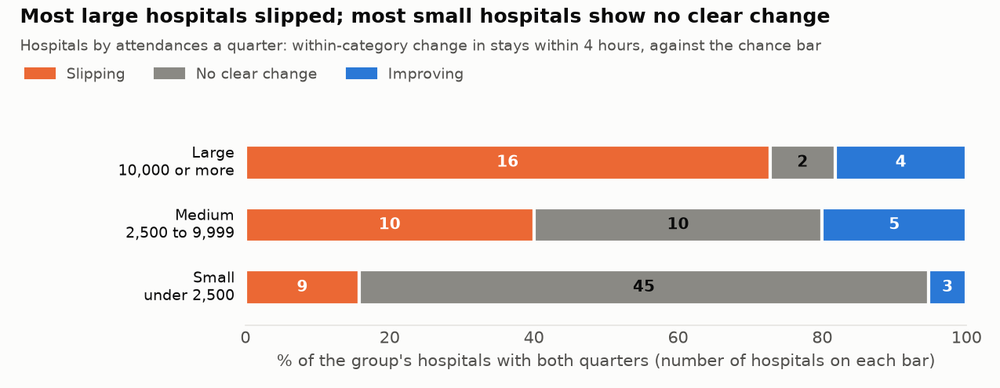
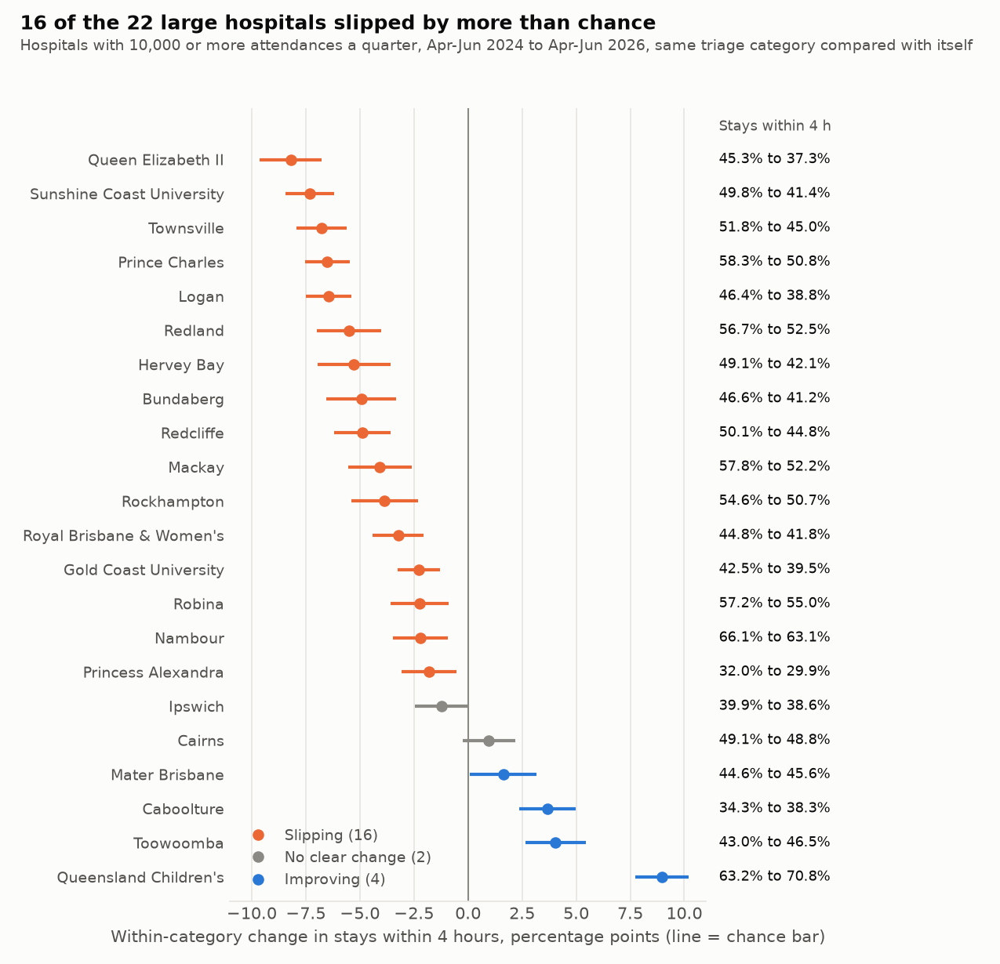
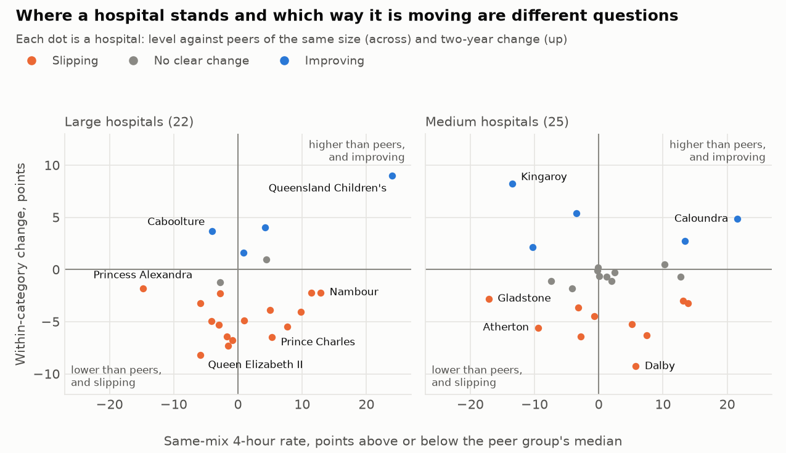

# Hospital scorecard: who is slipping and who is improving on 4-hour stays

*Generated by `scripts/scorecard_report.py` from the snapshot in `data/`. Do not edit by hand.*

Part 2 showed that the state's fall in emergency department (ED) stays within 4 hours is mostly patients in the same triage category taking longer, and that the large hospitals differ widely. This part scores every hospital on two separate questions, each against hospitals of a similar size: where does it stand, and which way is it moving?

## 1. Method

- **Peer groups by size.** Hospitals are grouped by attendances in Apr-Jun 2026: large (10,000 or more), medium (2,500 to 9,999) and small (under 2,500). These are working groups for this analysis, not Queensland Health's official peer groups.
- **Level: the same-mix rate.** A hospital with more urgent patients has a lower 4-hour rate for that reason alone. So each hospital's five category rates are weighted by its peer group's pooled triage mix, not its own. A hospital is **below peers** if that same-mix rate is in the lowest quarter of its group (and further below the group median than chance allows), **above peers** if it is in the highest quarter, and **in line** otherwise.
- **Trend: the within-category change**, Apr-Jun 2024 to Apr-Jun 2026 (Part 2's rule: the same quarter two years apart, both published to one decimal place). It is the change in the 4-hour rate with the effect of a changing triage mix taken out.
- **Chance bar.** A rate built from 300 patients moves from quarter to quarter by luck alone. Each change is compared with ±2.58 standard errors, treating every patient as an independent yes/no outcome. A hospital is **slipping** or **improving** only if its change is outside that bar; otherwise it is **no clear change**. With about 100 hospitals, a bar this wide should flag about one by luck. Stays in a crowded ED are not independent, so the true noise is probably larger than the bar: treat a flag as "worth a look", not as proof.
- **No official targets are applied.** Queensland Health's targets could not be confirmed from a primary source on the machine this was built on (its performance and budget sites refuse automated requests), so hospitals are scored against the median of their peer group instead. A peer median is a description of what similar hospitals do, not a standard of care.

## 2. The three peer groups

| Peer group (attendances in Apr-Jun 2026) | Hospitals | Share of attendances | Stays within 4 h, pooled | Median same-mix rate | Range of same-mix rates | Pooled change (points) | Mix | Within category |
| --- | ---: | ---: | ---: | ---: | ---: | ---: | ---: | ---: |
| Large (10,000 or more) | 22 | 70.2% | 45.7% | 44.3% | 29.5% to 68.3% | −3.47 | −0.60 | −2.87 |
| Medium (2,500 to 9,999) | 26 | 20.3% | 75.7% | 77.5% | 59.9% to 99.0% | −1.78 | −1.51 | −0.27 |
| Small (under 2,500) | 57 | 9.5% | 91.1% | 92.7% | 80.2% to 100.0% | −1.16 | −0.46 | −0.71 |

- The groups are far apart: the median same-mix rate is 44.3% for large hospitals, 77.5% for medium and 92.7% for small. Comparing a hospital with the state figure says more about its size than about how it is run.
- Even inside a group the spread is wide: 39 points between the highest and lowest large hospital on the same mix.
- Pooled, the within-category change is −2.87 points at the large hospitals, −0.27 at the medium and −0.71 at the small. Mater Springfield first reports in Apr-Jun 2026, so it has a level but no trend, and is left out of the pooled changes.
- 39 hospitals saw nobody in at least one triage category (almost always category 1). That category is left out of their same-mix rate; it is never more than 0.3% of the reference mix.

## 3. How many hospitals really moved?

| Peer group | Hospitals with both quarters | Slipping | No clear change | Improving | Median chance bar (points) |
| --- | ---: | ---: | ---: | ---: | ---: |
| Large | 22 | 16 | 2 | 4 | ±1.3 |
| Medium | 25 | 10 | 10 | 5 | ±2.1 |
| Small | 57 | 9 | 45 | 3 | ±2.9 |
| **All** | **104** | **35** | **57** | **12** | ±2.2 |

- **35 of 104 hospitals slipped by more than chance and 12 improved.** 57 show no clear change.
- On the published all-categories figure, 74 of 104 fell. The chance bar removes most of the small hospitals from that list: 45 of 57 small hospitals show no clear change, although 4 of them moved by 3 points or more on the published figure. A small hospital's bar is about ±2.9 points, against ±1.3 for a large one.
- **Slipping is the norm among large hospitals**: 16 of 22, against 10 of 25 medium and 9 of 57 small.

## 4. Large hospitals

Largest within-category fall first. Peer median same-mix rate: 44.3%.

| Hospital | Attendances, Apr-Jun 2026 | Within 4 h, Apr-Jun 2024 | Within 4 h, Apr-Jun 2026 | Same-mix rate | Against peer median (points) | Level | Within-category change (points) | Chance bar | Trend | Seen on time: within-category change | Seen on time: trend |
| --- | ---: | ---: | ---: | ---: | ---: | ---: | ---: | ---: | ---: | ---: | ---: |
| Queen Elizabeth II | 14,971 | 45.3% | 37.3% | 38.5% | −5.9 | below peers | −8.2 | ±1.4 | slipping | +0.2 | no clear change |
| Sunshine Coast University | 24,756 | 49.8% | 41.4% | 42.8% | −1.5 | in line | −7.3 | ±1.1 | slipping | −4.9 | slipping |
| Townsville | 23,449 | 51.8% | 45.0% | 43.5% | −0.9 | in line | −6.8 | ±1.2 | slipping | −2.9 | slipping |
| Prince Charles | 27,627 | 58.3% | 50.8% | 49.6% | +5.3 | above peers | −6.5 | ±1.0 | slipping | −6.9 | slipping |
| Logan | 29,727 | 46.4% | 38.8% | 42.5% | −1.8 | in line | −6.4 | ±1.1 | slipping | +4.2 | improving |
| Redland | 14,563 | 56.7% | 52.5% | 52.0% | +7.7 | above peers | −5.5 | ±1.5 | slipping | −0.3 | no clear change |
| Hervey Bay | 10,782 | 49.1% | 42.1% | 41.3% | −3.0 | below peers | −5.3 | ±1.7 | slipping | −13.7 | slipping |
| Bundaberg | 11,322 | 46.6% | 41.2% | 40.2% | −4.1 | below peers | −4.9 | ±1.6 | slipping | +9.1 | improving |
| Redcliffe | 18,707 | 50.1% | 44.8% | 45.2% | +0.9 | in line | −4.9 | ±1.3 | slipping | +16.2 | improving |
| Mackay | 13,673 | 57.8% | 52.2% | 54.1% | +9.8 | above peers | −4.1 | ±1.5 | slipping | −3.5 | slipping |
| Rockhampton | 13,209 | 54.6% | 50.7% | 49.3% | +5.0 | in line | −3.9 | ±1.5 | slipping | −13.0 | slipping |
| Royal Brisbane & Women's | 22,158 | 44.8% | 41.8% | 38.4% | −5.9 | below peers | −3.2 | ±1.2 | slipping | −2.4 | slipping |
| Gold Coast University | 31,831 | 42.5% | 39.5% | 41.5% | −2.8 | in line | −2.3 | ±1.0 | slipping | +0.3 | no clear change |
| Robina | 18,995 | 57.2% | 55.0% | 55.7% | +11.4 | above peers | −2.2 | ±1.3 | slipping | +4.1 | improving |
| Nambour | 17,122 | 66.1% | 63.1% | 57.2% | +12.9 | above peers | −2.2 | ±1.3 | slipping | −0.8 | no clear change |
| Princess Alexandra | 17,637 | 32.0% | 29.9% | 29.5% | −14.8 | below peers | −1.8 | ±1.3 | slipping | +1.2 | no clear change |
| Ipswich | 19,666 | 39.9% | 38.6% | 41.5% | −2.8 | in line | −1.2 | ±1.2 | no clear change | +9.7 | improving |
| Cairns | 21,694 | 49.1% | 48.8% | 48.7% | +4.4 | in line | +1.0 | ±1.2 | no clear change | +0.3 | no clear change |
| Mater Brisbane | 12,488 | 44.6% | 45.6% | 45.2% | +0.9 | in line | +1.6 | ±1.6 | improving | +11.3 | improving |
| Caboolture | 17,994 | 34.3% | 38.3% | 40.3% | −4.0 | below peers | +3.7 | ±1.3 | improving | +8.6 | improving |
| Toowoomba | 16,348 | 43.0% | 46.5% | 48.5% | +4.2 | in line | +4.0 | ±1.4 | improving | +4.9 | improving |
| Queensland Children's | 17,413 | 63.2% | 70.8% | 68.3% | +24.0 | above peers | +9.0 | ±1.2 | improving | +8.1 | improving |

- **Queen Elizabeth II** has the largest within-category fall (−8.2 points) and **Queensland Children's** the largest gain (+9.0).
- **Princess Alexandra** has the lowest same-mix rate (29.5%, 14.8 points under the peer median).
- **In patients:** at the 16 slipping large hospitals the within-category falls add up to roughly 14,800 more stays over 4 hours in the quarter than their Apr-Jun 2024 category rates would give (of 310,529 attendances). The 4 improving hospitals are roughly 3,100 stays better off.

## 5. Medium hospitals

Peer median same-mix rate: 77.5%.

| Hospital | Attendances, Apr-Jun 2026 | Within 4 h, Apr-Jun 2024 | Within 4 h, Apr-Jun 2026 | Same-mix rate | Against peer median (points) | Level | Within-category change (points) | Chance bar | Trend | Seen on time: within-category change | Seen on time: trend |
| --- | ---: | ---: | ---: | ---: | ---: | ---: | ---: | ---: | ---: | ---: | ---: |
| Dalby | 3,597 | 93.1% | 84.0% | 83.3% | +5.8 | in line | −9.3 | ±1.9 | slipping | −1.0 | no clear change |
| Proserpine | 4,438 | 83.9% | 72.9% | 74.7% | −2.8 | in line | −6.4 | ±2.1 | slipping | −5.9 | slipping |
| Gatton | 2,628 | 91.7% | 85.3% | 84.9% | +7.4 | above peers | −6.3 | ±2.2 | slipping | +0.8 | no clear change |
| Atherton | 4,982 | 75.7% | 69.0% | 68.1% | −9.4 | below peers | −5.6 | ±2.2 | slipping | +4.5 | improving |
| Ingham | 2,722 | 89.6% | 84.6% | 82.7% | +5.2 | in line | −5.3 | ±2.3 | slipping | −5.9 | slipping |
| Mareeba | 5,470 | 83.8% | 78.9% | 76.8% | −0.7 | in line | −4.5 | ±1.8 | slipping | +14.3 | improving |
| Mossman | 3,202 | 83.0% | 76.7% | 74.3% | −3.2 | in line | −3.6 | ±2.3 | slipping | +10.5 | improving |
| Charters Towers | 2,735 | 96.5% | 92.7% | 91.4% | +13.9 | above peers | −3.3 | ±1.5 | slipping | −8.5 | slipping |
| Chinchilla | 2,579 | 96.7% | 93.1% | 90.6% | +13.1 | above peers | −3.0 | ±1.5 | slipping | −6.8 | slipping |
| Gladstone | 8,321 | 61.1% | 55.3% | 60.4% | −17.1 | below peers | −2.8 | ±1.9 | slipping | −3.3 | slipping |
| Warwick | 5,213 | 74.5% | 71.4% | 73.4% | −4.1 | below peers | −1.8 | ±2.1 | no clear change | +9.9 | improving |
| Beaudesert | 4,548 | 80.5% | 78.0% | 79.5% | +2.0 | in line | −1.1 | ±2.2 | no clear change | −3.3 | slipping |
| Maryborough | 6,293 | 69.3% | 67.1% | 70.0% | −7.5 | below peers | −1.1 | ±2.1 | no clear change | −2.0 | no clear change |
| Goondiwindi | 2,855 | 93.5% | 92.2% | 90.2% | +12.7 | above peers | −0.7 | ±1.7 | no clear change | +2.9 | improving |
| Mount Isa | 8,313 | 81.4% | 79.5% | 78.8% | +1.3 | in line | −0.7 | ±1.5 | no clear change | +9.4 | improving |
| Innisfail | 4,257 | 80.3% | 79.8% | 77.6% | +0.1 | in line | −0.6 | ±2.1 | no clear change | +20.3 | improving |
| Roma | 2,818 | 83.2% | 80.8% | 80.0% | +2.5 | in line | −0.3 | ±2.5 | no clear change | +1.3 | improving |
| Emerald | 4,129 | 77.6% | 77.5% | 77.3% | −0.2 | in line | −0.1 | ±2.3 | no clear change | −8.2 | slipping |
| Bowen | 3,276 | 81.4% | 78.9% | 77.4% | −0.1 | in line | +0.2 | ±2.3 | no clear change | −9.7 | slipping |
| Ayr | 3,830 | 90.0% | 89.5% | 87.8% | +10.3 | above peers | +0.5 | ±1.7 | no clear change | −12.5 | slipping |
| Gympie | 8,979 | 62.3% | 61.9% | 67.2% | −10.3 | below peers | +2.1 | ±1.8 | improving | +22.8 | improving |
| Stanthorpe | 2,528 | 88.8% | 91.5% | 90.9% | +13.4 | above peers | +2.7 | ±2.2 | improving | +6.6 | improving |
| Caloundra | 8,589 | 93.8% | 98.7% | 99.0% | +21.5 | above peers | +4.8 | ±0.8 | improving | +13.5 | improving |
| Capricorn Coast | 4,770 | 68.0% | 71.1% | 74.0% | −3.5 | in line | +5.4 | ±2.3 | improving | +3.2 | improving |
| Kingaroy | 5,570 | 56.8% | 60.1% | 64.0% | −13.5 | below peers | +8.2 | ±2.2 | improving | +11.6 | improving |
| Mater Springfield | 4,062 | n/a | 53.6% | 59.9% | −17.6 | below peers | n/a | n/a | new | n/a | new |

- The largest fall is at **Dalby** (−9.3 points) and the largest gain at **Kingaroy** (+8.2).
- **Caloundra** is the outlier at the top: 98.7% of stays within 4 hours with 8,589 attendances, 21.5 points above the peer median on the same mix. The data does not say why (it may run a different kind of service from its peers), so it is a hospital to ask about, not a benchmark to copy.
- **Mater Springfield** is new. Its first quarter is 53.6%, the lowest same-mix rate in the group (59.9%); one quarter is too little to judge a new ED on.

## 6. Small hospitals

57 hospitals; peer median same-mix rate 92.7%. Only the 12 whose change is outside the chance bar are listed. All are in `scorecard_hospitals.csv`.

| Hospital | Attendances, Apr-Jun 2026 | Within 4 h, Apr-Jun 2024 | Within 4 h, Apr-Jun 2026 | Same-mix rate | Against peer median (points) | Level | Within-category change (points) | Chance bar | Trend | Seen on time: within-category change | Seen on time: trend |
| --- | ---: | ---: | ---: | ---: | ---: | ---: | ---: | ---: | ---: | ---: | ---: |
| Longreach | 1,562 | 89.3% | 81.8% | 80.2% | −12.5 | below peers | −6.6 | ±3.1 | slipping | −1.2 | no clear change |
| Barcaldine | 457 | 93.3% | 86.9% | 87.9% | −4.7 | below peers | −6.0 | ±4.9 | slipping | −1.8 | no clear change |
| Normanton | 1,259 | 95.2% | 90.1% | 88.7% | −3.9 | below peers | −6.0 | ±3.0 | slipping | −1.1 | no clear change |
| Doomadgee | 1,997 | 95.9% | 90.3% | 90.0% | −2.7 | in line | −5.3 | ±2.0 | slipping | +0.6 | no clear change |
| Clermont MPHS | 1,130 | 95.2% | 92.2% | 91.8% | −0.9 | in line | −4.3 | ±3.0 | slipping | −10.6 | slipping |
| Moranbah | 2,017 | 93.2% | 88.3% | 89.2% | −3.5 | below peers | −3.9 | ±2.3 | slipping | −4.3 | slipping |
| Tully | 2,486 | 86.6% | 82.1% | 83.2% | −9.4 | below peers | −3.4 | ±2.6 | slipping | −6.4 | slipping |
| Miles | 1,055 | 97.1% | 94.1% | 92.7% | 0.0 | in line | −2.6 | ±2.2 | slipping | −3.8 | slipping |
| Sarina | 2,073 | 96.8% | 94.0% | 94.2% | +1.5 | in line | −1.9 | ±1.6 | slipping | +0.5 | no clear change |
| Esk | 1,081 | 85.0% | 88.3% | 90.2% | −2.5 | in line | +4.7 | ±3.8 | improving | +3.1 | improving |
| Kilcoy | 779 | 90.1% | 95.5% | 95.1% | +2.4 | in line | +5.3 | ±3.0 | improving | +3.4 | improving |
| Biloela | 1,734 | 86.8% | 91.9% | 93.4% | +0.7 | in line | +5.6 | ±2.5 | improving | +1.8 | no clear change |

- For the other 45 the data cannot tell a real change from luck. The widest bar is ±8.9 points (Mungindi, 149 attendances in the quarter).
- A rate of exactly 100% or 0% in a category has no chance bar under this method, so the bar is slightly too narrow for the very smallest hospitals. Their flags deserve the most caution.

## 7. Level against trend

| Level | Slipping | No clear change | Improving | All |
| --- | ---: | ---: | ---: | ---: |
| Below peers | 12 | 10 | 3 | 25 |
| In line | 15 | 30 | 6 | 51 |
| Above peers | 8 | 17 | 3 | 28 |

### Below peers and slipping: 12 hospitals

| Hospital | Peer group | Attendances, Apr-Jun 2026 | Within 4 h, Apr-Jun 2024 | Within 4 h, Apr-Jun 2026 | Same-mix rate | Peer median | Within-category change (points) | Chance bar | Seen on time: trend |
| --- | ---: | ---: | ---: | ---: | ---: | ---: | ---: | ---: | ---: |
| Queen Elizabeth II | Large | 14,971 | 45.3% | 37.3% | 38.5% | 44.3% | −8.2 | ±1.4 | no clear change |
| Hervey Bay | Large | 10,782 | 49.1% | 42.1% | 41.3% | 44.3% | −5.3 | ±1.7 | slipping |
| Bundaberg | Large | 11,322 | 46.6% | 41.2% | 40.2% | 44.3% | −4.9 | ±1.6 | improving |
| Royal Brisbane & Women's | Large | 22,158 | 44.8% | 41.8% | 38.4% | 44.3% | −3.2 | ±1.2 | slipping |
| Princess Alexandra | Large | 17,637 | 32.0% | 29.9% | 29.5% | 44.3% | −1.8 | ±1.3 | no clear change |
| Atherton | Medium | 4,982 | 75.7% | 69.0% | 68.1% | 77.5% | −5.6 | ±2.2 | improving |
| Gladstone | Medium | 8,321 | 61.1% | 55.3% | 60.4% | 77.5% | −2.8 | ±1.9 | slipping |
| Longreach | Small | 1,562 | 89.3% | 81.8% | 80.2% | 92.7% | −6.6 | ±3.1 | no clear change |
| Barcaldine | Small | 457 | 93.3% | 86.9% | 87.9% | 92.7% | −6.0 | ±4.9 | no clear change |
| Normanton | Small | 1,259 | 95.2% | 90.1% | 88.7% | 92.7% | −6.0 | ±3.0 | no clear change |
| Moranbah | Small | 2,017 | 93.2% | 88.3% | 89.2% | 92.7% | −3.9 | ±2.3 | slipping |
| Tully | Small | 2,486 | 86.6% | 82.1% | 83.2% | 92.7% | −3.4 | ±2.6 | slipping |

- These 12 (5 large, 2 medium, 5 small) are already in the lowest quarter of their group and still falling. They are the first places to look.
- **A good level can hide a slide.** 8 hospitals are in the top quarter of their group and slipping: Prince Charles, Redland, Mackay, Robina, Nambour, Gatton, Charters Towers, Chinchilla. A league table of levels would show them as fine.
- **A poor level can hide a recovery.** 3 are in the lowest quarter and improving: Caboolture, Gympie, Kingaroy.

## 8. When did it happen, and does the front door move with it?

Splitting the two years at Apr-Jun 2025 (each year's within-category change, so the two do not add up exactly to the two-year figure), for the 35 slipping hospitals:

- **20** fell in both years.
- **9** fell in the first year only, and have been level or better since (for example Dalby, Mackay, Atherton).
- **6** fell in the second year only (for example Queen Elizabeth II, Redland, Barcaldine): the most recent, and the ones a year-old review would have missed.
- Single-year changes have wider chance bars than the two-year change, so read this as a pointer to timing, not a second test.

Patients seen within the recommended time, scored the same way (within-category change against its own chance bar; changes only, as Part 2 found the level does not rebuild exactly):

| 4-hour stays ↓ / seen on time → | Slipping | No clear change | Improving |
| --- | ---: | ---: | ---: |
| Slipping | 16 | 12 | 7 |
| No clear change | 10 | 35 | 12 |
| Improving | 0 | 1 | 11 |

- Of the 35 hospitals slipping on 4-hour stays, 16 are also slipping on seeing patients on time and 7 are *improving* on it.
- Of the 12 improving on 4-hour stays, 11 are also improving on seeing patients on time and none is slipping.
- So in this data no hospital improved its 4-hour rate while its front door got worse, but several improved the front door while the 4-hour rate fell. Part 4 looks at those hospitals' waits, walk-outs and admitted-patient delays.

## 9. What this means

1. **Judge a hospital against hospitals its own size, on the same mix.** The peer medians run from 44.3% (large) to 92.7% (small). Against the state figure of 56.1%, 20 of the 22 large hospitals are below and all 57 small hospitals are above, which says nothing about any of them.
2. **Start with the 12 hospitals that are below peers and slipping**, then the 8 whose high level hides a fall. Level and trend need separate columns in any performance report.
3. **Do not chase small hospitals' quarterly swings.** 45 of 57 show no change that chance could not produce. Review them on a rolling year, or only when a change clears the bar.
4. **The slide is concentrated where the patients are.** 16 of 22 large hospitals are slipping, worth roughly 14,800 more stays over 4 hours a quarter than their Apr-Jun 2024 category rates would give.
5. **Ask the improvers what changed.** Queensland Children's and the other 11 improving hospitals moved against the statewide trend. The data shows that they did, not how.

## 10. Rules carried into Part 4

1. Keep the three peer groups and compare levels on the peer group's mix.
2. Call a change real only when it clears the chance bar, and say that the bar is a floor.
3. Keep level and trend as separate verdicts.
4. Peer medians are not targets. If official targets are confirmed later, add them as a separate column.
