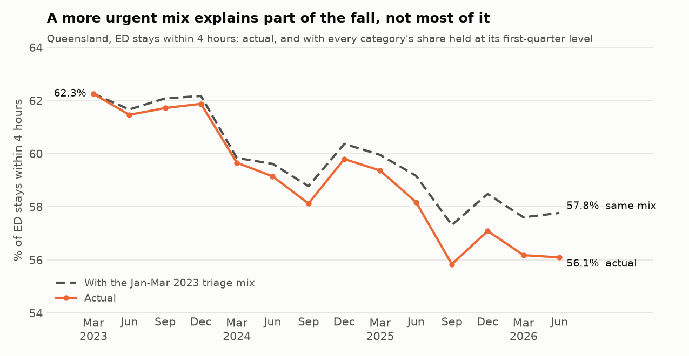
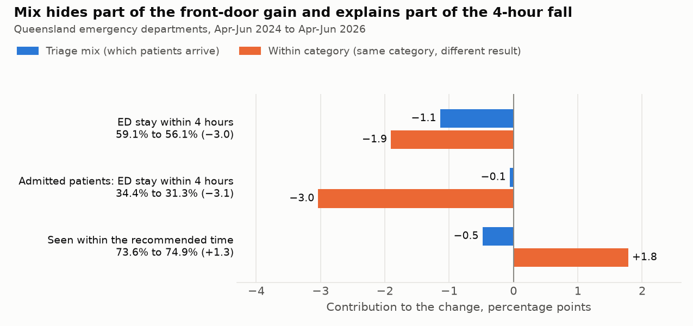
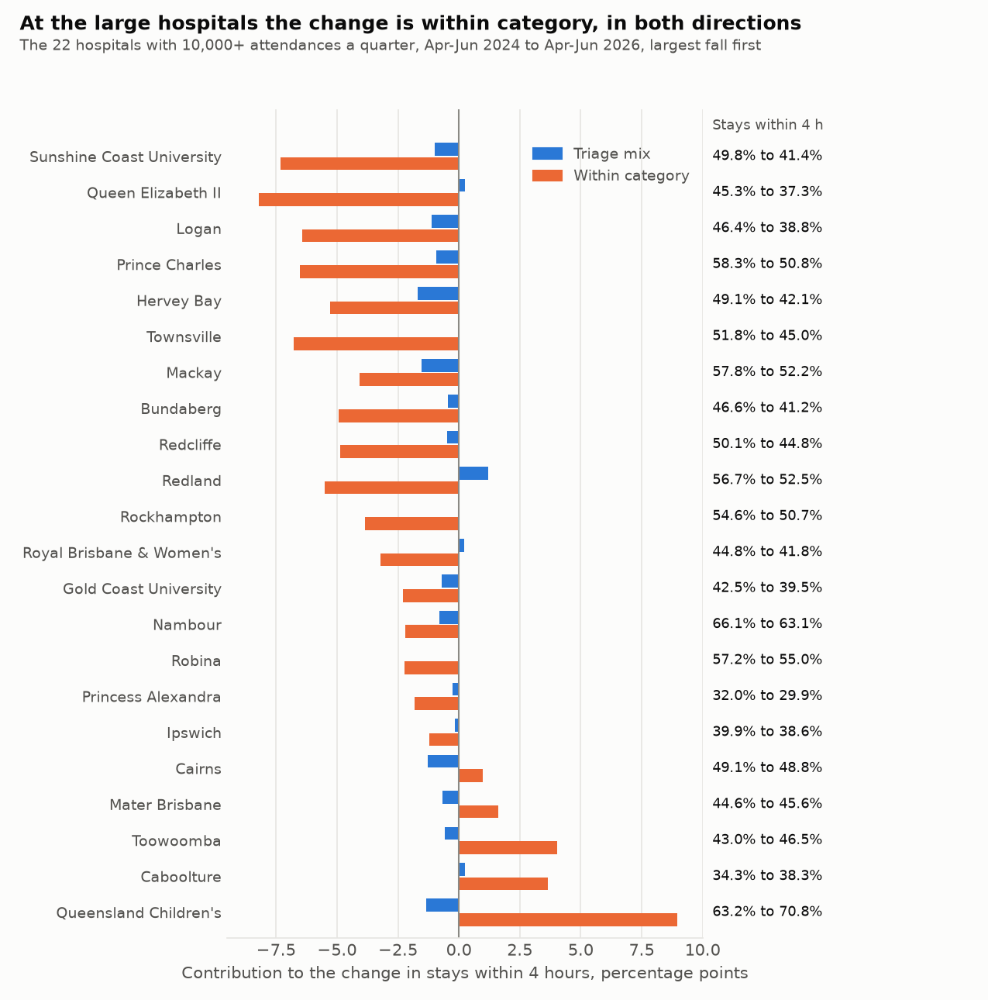

# Mix versus performance: why fewer ED stays finish within 4 hours

*Generated by `scripts/mix_report.py` from the snapshot in `data/`. Do not edit by hand.*

Part 1 found two things moving at once: fewer emergency department (ED) stays finish within 4 hours, and more patients arrive in the urgent triage categories, where fewer stays finish within 4 hours. This part separates them. "Mix" is the part of a change that comes from *which* patients arrive. "Within category" is the part that comes from patients in the same triage category getting a different result, which is closer to a measure of performance.

## 1. Method

An all-categories rate is the weighted average of the five triage categories, each weighted by its share of patients. Between two quarters the change splits exactly into two parts, with nothing left over:

- **mix effect**: each category's change in share × its average rate over the two quarters, summed;
- **within-category effect**: each category's change in rate × its average share, summed.

The main comparison is **Apr-Jun 2024 to Apr-Jun 2026**: the same quarter two years apart, and the longest like-for-like span in which every figure is published to one decimal place. The three-year comparison from Apr-Jun 2023 is given with a margin, because that quarter was published in whole percentages.

**Does the method fit the data?** Rebuilding the published all-categories figure from the five categories:

| Measure | Weighted by | Largest gap, 9 one-decimal quarters (points) | Largest gap, 5 whole-number quarters (points) |
| --- | ---: | ---: | ---: |
| ED stay within 4 hours | attendances | 0.06 | 0.46 |
| Admitted from the ED | attendances | 0.05 | 0.57 |
| Admitted patients: ED stay within 4 hours | admitted patients (attendances × admitted share) | 0.06 | 0.11 |
| Seen within the recommended time | attendances | 0.37 | 0.81 |

Three of the four rebuild to within rounding. "Seen within the recommended time" does not: the rebuilt figure is 0.26 to 0.37 points above the published one in every one-decimal quarter, so its published total is not a plain attendance-weighted average of the categories (the source does not say what it leaves out). The gap is steady, moving by at most 0.12 points between those quarters, so the split of a *change* in that measure is still usable, to about a tenth of a point.

## 2. Stays within 4 hours: the triage mix is over a third of the fall

Queensland, Apr-Jun 2024 to Apr-Jun 2026:

| Triage category | Share, Apr-Jun 2024 | Share, Apr-Jun 2026 | Within 4 h, Apr-Jun 2024 | Within 4 h, Apr-Jun 2026 | Mix effect (points) | Within-category effect (points) |
| --- | ---: | ---: | ---: | ---: | ---: | ---: |
| 1 resuscitation | 0.9% | 0.9% | 41.9% | 40.9% | 0.00 | −0.01 |
| 2 emergency | 17.9% | 20.0% | 44.1% | 41.3% | +0.88 | −0.53 |
| 3 urgent | 41.7% | 42.8% | 49.2% | 46.7% | +0.53 | −1.06 |
| 4 semi-urgent | 31.0% | 29.2% | 73.1% | 72.2% | −1.29 | −0.27 |
| 5 non-urgent | 8.4% | 7.0% | 91.0% | 90.5% | −1.27 | −0.04 |
| **All** | 100.0% | 100.0% | 59.1% | 56.1% | **−1.14** | **−1.91** |

- Stays within 4 hours fell **3.05 points** (59.1% to 56.1%).
- **1.14 points (37%) is mix**: categories 4 and 5, where most patients leave within 4 hours, shrank from 39.4% to 36.2% of attendances, and category 2 grew from 17.9% to 20.0%.
- **1.91 points (63%) is within category**: the 4-hour rate fell in all five categories. Category 3 accounts for the most (−1.06 points): it fell from 49.2% to 46.7% and is the largest category.
- Rounding in the published rates could move the within-category figure by up to 0.10 points and the mix figure by less than 0.01.

**Over three years** (Apr-Jun 2023 to Apr-Jun 2026) the rebuilt rate fell 5.37 points: 1.37 mix and 4.00 within category. The start quarter is rounded to whole percentages, so the within-category figure is good to ±0.55 points; mix is then 23% to 28% of the fall.

**Every year-on-year comparison agrees on the sign of the mix effect.** Each quarter against the same quarter a year earlier:

| Comparison | Change (points) | Mix | Within category |
| --- | ---: | ---: | ---: |
| Jan-Mar 2023 to Jan-Mar 2024 * | −2.59 | −0.18 | −2.41 |
| Apr-Jun 2023 to Apr-Jun 2024 * | −2.32 | −0.25 | −2.07 |
| Jul-Sep 2023 to Jul-Sep 2024 * | −3.59 | −0.24 | −3.35 |
| Oct-Dec 2023 to Oct-Dec 2024 * | −2.08 | −0.23 | −1.84 |
| Jan-Mar 2024 to Jan-Mar 2025 * | −0.30 | −0.38 | +0.08 |
| Apr-Jun 2024 to Apr-Jun 2025 | −0.97 | −0.50 | −0.47 |
| Jul-Sep 2024 to Jul-Sep 2025 | −2.28 | −0.81 | −1.47 |
| Oct-Dec 2024 to Oct-Dec 2025 | −2.71 | −0.82 | −1.89 |
| Jan-Mar 2025 to Jan-Mar 2026 | −3.18 | −0.81 | −2.38 |
| Apr-Jun 2025 to Apr-Jun 2026 | −2.08 | −0.64 | −1.44 |

\* one or both quarters published in whole percentages; the within-category figure is good to about half a point.

- Mix lowered the rate in 10 of 10 comparisons, and the pull is growing: it averaged 0.23 points a year in the first four comparisons and 0.77 in the last four.
- The within-category effect was negative in 9 of 10 and is the larger of the two in 8 of 10.

Another way to see it: hold each category's share at its Jan-Mar 2023 level and apply each quarter's own category rates. On that fixed mix the Apr-Jun 2026 figure would be 57.8% instead of 56.1%: 1.7 points higher, but still 4.5 points below where it started (62.3%). (This uses start-quarter shares over the whole period, so it does not match the two-quarter splits above to the decimal.)

## 3. The other measures

| Measure (rebuilt from categories) | Apr-Jun 2024 | Apr-Jun 2026 | Change (points) | Mix | Within category |
| --- | ---: | ---: | ---: | ---: | ---: |
| ED stay within 4 hours | 59.1% | 56.1% | −3.05 | −1.14 | −1.91 |
| Admitted patients: ED stay within 4 hours | 34.4% | 31.3% | −3.10 | −0.06 | −3.04 |
| Seen within the recommended time | 73.6% | 74.9% | +1.30 | −0.48 | +1.78 |
| Admitted from the ED | 28.1% | 29.0% | +0.86 | +1.13 | −0.27 |

- **Seen on time: the front-door gain is larger than the headline.** The rate rose 1.30 points, but the mix pulled it down by 0.48; within categories the gain was 1.78 points, most of it in category 3 (66.1% to 68.8%).
  It is not a steady gain, though: the within-category effect was negative in 3 of 10 year-on-year comparisons, all 3 of them ending between Jul-Sep 2025 and Jan-Mar 2026.
- **Admitted patients: none of the fall is mix.** The share of admitted patients whose ED stay was within 4 hours fell 3.10 points, 3.04 of it within category. It fell in all five categories. Admitted patients are spread across triage categories much as they were, so the mix cannot explain it.
- **Admissions: the mix effect is partly offset.** A more urgent mix alone would have lifted the admitted share by 1.13 points. It rose 0.86, largely because the admission rate *within* category 2 fell from 50.6% to 47.6%.

## 4. Is the mix shift real?

The last point matters. Category 2 grew from 17.9% to 20.0% of attendances while a smaller share of its patients were admitted (50.6% to 47.6%). That is what you would see if some patients who used to be triaged as category 3 are now triaged as category 2. It is also what you would see if more genuinely urgent patients arrive who do not need a bed. Quarterly totals cannot separate the two, and this split only sees how sick a patient is through the triage category. So the mix effect of 1.14 points cannot be read straight off as "sicker patients".

A second split does not rely on triage at all. It treats each quarter as two groups, admitted and not admitted. The 4-hour rate of patients who were not admitted is not published, but the three published figures imply it (stays = admitted share × admitted rate + the rest × the not-admitted rate):

| Group | Share, Apr-Jun 2024 | Share, Apr-Jun 2026 | Within 4 h, Apr-Jun 2024 | Within 4 h, Apr-Jun 2026 | Mix effect (points) | Within-group effect (points) |
| --- | ---: | ---: | ---: | ---: | ---: | ---: |
| Admitted | 28.1% | 29.0% | 34.5% | 31.3% | +0.30 | −0.91 |
| Not admitted | 71.9% | 71.0% | 68.7% | 66.2% | −0.61 | −1.78 |
| **All** | 100.0% | 100.0% | 59.1% | 56.1% | **−0.31** | **−2.69** |

- The not-admitted rates are implied, not published, and are good to about ±0.1 points given the rounding of the inputs. They also rest on reading "admissions to hospital within 4 hours" as the share of admitted patients whose ED stay was within 4 hours.
- On this split only 0.31 of the 3.0 points (10%) comes from admitting a larger share of patients.
- **Patients who were not admitted account for more of the fall than patients who were**: 1.78 points against 0.91. Their rate fell less (68.7% to 66.2%, against 34.5% to 31.3%), but they are 71% of attendances.

The two splits put mix at 10% and 37% of the fall. In both, the larger part is patients in the same group taking longer.

## 5. Large hospitals: mostly within category, not mix

| Hospitals by attendances in Apr-Jun 2026 | Hospitals | Within 4 h, Apr-Jun 2024 | Within 4 h, Apr-Jun 2026 | Change (points) | Mix | Within category |
| --- | ---: | ---: | ---: | ---: | ---: | ---: |
| 10,000 or more attendances | 22 | 49.2% | 45.7% | −3.47 | −0.60 | −2.87 |
| Under 10,000 | 82 | 82.7% | 81.3% | −1.43 | −1.14 | −0.29 |

Each group's hospitals are added together, category by category. 1 hospital that first reports in Apr-Jun 2026 is left out.

- At the **22 large hospitals** the 4-hour rate fell 3.47 points and 2.87 of that (83%) is within category.
- At the **other 82** it fell 1.43 points and 1.14 of that (80%) is mix: like for like, they are close to where they were.
- Seen on time, within category: +1.29 points at the large hospitals and +3.06 at the rest.

### The 22 large hospitals, Apr-Jun 2024 to Apr-Jun 2026

| Hospital | Attendances, Apr-Jun 2026 | Within 4 h, Apr-Jun 2024 | Within 4 h, Apr-Jun 2026 | Change (points) | Mix | Within category | Categories 1-2 share, Apr-Jun 2024 | Categories 1-2 share, Apr-Jun 2026 |
| --- | ---: | ---: | ---: | ---: | ---: | ---: | ---: | ---: |
| Sunshine Coast University | 24,756 | 49.8% | 41.4% | −8.3 | −1.0 | −7.3 | 24.8% | 24.6% |
| Queen Elizabeth II | 14,971 | 45.3% | 37.3% | −8.0 | +0.2 | −8.2 | 21.7% | 22.9% |
| Logan | 29,727 | 46.4% | 38.8% | −7.5 | −1.1 | −6.4 | 34.1% | 40.4% |
| Prince Charles | 27,627 | 58.3% | 50.8% | −7.4 | −0.9 | −6.5 | 17.8% | 19.7% |
| Hervey Bay | 10,782 | 49.1% | 42.1% | −7.0 | −1.7 | −5.3 | 15.9% | 20.8% |
| Townsville | 23,449 | 51.8% | 45.0% | −6.8 | 0.0 | −6.8 | 15.7% | 16.2% |
| Mackay | 13,673 | 57.8% | 52.2% | −5.6 | −1.5 | −4.1 | 28.9% | 32.1% |
| Bundaberg | 11,322 | 46.6% | 41.2% | −5.4 | −0.5 | −4.9 | 18.4% | 19.0% |
| Redcliffe | 18,707 | 50.1% | 44.8% | −5.4 | −0.5 | −4.9 | 13.7% | 16.9% |
| Redland | 14,563 | 56.7% | 52.5% | −4.3 | +1.2 | −5.5 | 24.0% | 24.8% |
| Rockhampton | 13,209 | 54.6% | 50.7% | −3.9 | 0.0 | −3.9 | 19.1% | 20.9% |
| Royal Brisbane & Women's | 22,158 | 44.8% | 41.8% | −3.0 | +0.2 | −3.2 | 17.1% | 17.0% |
| Gold Coast University | 31,831 | 42.5% | 39.5% | −3.0 | −0.7 | −2.3 | 29.7% | 33.4% |
| Nambour | 17,122 | 66.1% | 63.1% | −3.0 | −0.8 | −2.2 | 14.1% | 15.3% |
| Robina | 18,995 | 57.2% | 55.0% | −2.2 | 0.0 | −2.2 | 25.3% | 23.5% |
| Princess Alexandra | 17,637 | 32.0% | 29.9% | −2.1 | −0.3 | −1.8 | 32.5% | 33.2% |
| Ipswich | 19,666 | 39.9% | 38.6% | −1.4 | −0.1 | −1.2 | 33.5% | 35.7% |
| Cairns | 21,694 | 49.1% | 48.8% | −0.3 | −1.3 | +1.0 | 21.3% | 23.9% |
| Mater Brisbane | 12,488 | 44.6% | 45.6% | +1.0 | −0.7 | +1.6 | 22.9% | 24.6% |
| Toowoomba | 16,348 | 43.0% | 46.5% | +3.5 | −0.6 | +4.0 | 22.9% | 27.7% |
| Caboolture | 17,994 | 34.3% | 38.3% | +3.9 | +0.3 | +3.7 | 23.5% | 24.9% |
| Queensland Children's | 17,413 | 63.2% | 70.8% | +7.6 | −1.4 | +9.0 | 13.7% | 14.3% |

- **18 of 22 fell and 4 rose.** 9 fell by 5 points or more, led by Sunshine Coast University (49.8% to 41.4%). Queensland Children's improved the most (63.2% to 70.8%).
- **Mix is the larger effect at 1 of 22**, and the within-category effect has the same sign as the total change at 21 of 22. The spread in the within-category effect (−8.2 to +9.0 points) is far wider than in the mix effect (−1.7 to +1.2).
- **The triage shift is uneven.** Categories 1 and 2 together went from 34.1% to 40.4% of attendances at Logan, the largest rise; at 7 of the 22 the share moved by less than a point.

### Front door and back door

Within category, over the same two years, at the 22 large hospitals:

- **8** got better at seeing patients on time and worse on 4-hour stays (for example Queen Elizabeth II, Logan, Bundaberg).
- **9** got worse on both (Hervey Bay, Rockhampton, Prince Charles had the largest falls in patients seen on time).
- **5** got better on both (Queensland Children's, Toowoomba, Caboolture, Mater Brisbane, Cairns).

Across the 22, the correlation between the two within-category effects is 0.44: a moderate link, with 8 hospitals moving in opposite directions. A better front door does not by itself bring back the 4-hour rate. Part 4 looks at both, hospital by hospital.

## 6. What this means

1. **Do not explain the 4-hour fall away as "sicker patients".** On the triage split, mix is 37% of the two-year fall; on the admitted split it is 10%. Either way most of it is patients in the same group taking longer.
2. **Report within-category rates next to the headline.** The headline understates the gain in patients seen on time and overstates the loss in 4-hour stays, and the yearly pull from the mix has grown.
3. **Look at the large hospitals one at a time.** As a group their fall is 83% within category, but 4 of the 22 improved while 9 fell by 5 points or more. A state average hides both.
4. **The fall is not only among admitted patients.** Admitted patients' 4-hour rate fell the most, but patients who were not admitted account for 1.78 of the 3.0 points. Part 1's "back door" reading needs that correction: patients who are not admitted are leaving later too.
5. **Check triage practice before crediting or blaming the mix.** Category 2 is growing while a smaller share of it is admitted. A hospital can find out which explanation holds from its own patient-level records; this data cannot.

## 7. Rules carried into Part 3

1. Score hospitals on within-category change, not on the all-categories figure.
2. Compare Apr-Jun 2024 with Apr-Jun 2026 (both one decimal); use earlier quarters only with the half-point margin.
3. "Seen within the recommended time" does not rebuild exactly from its categories. Use changes, not levels, from the rebuilt figure.
4. The not-admitted 4-hour rate is implied, not published. Label it that way wherever it appears.
