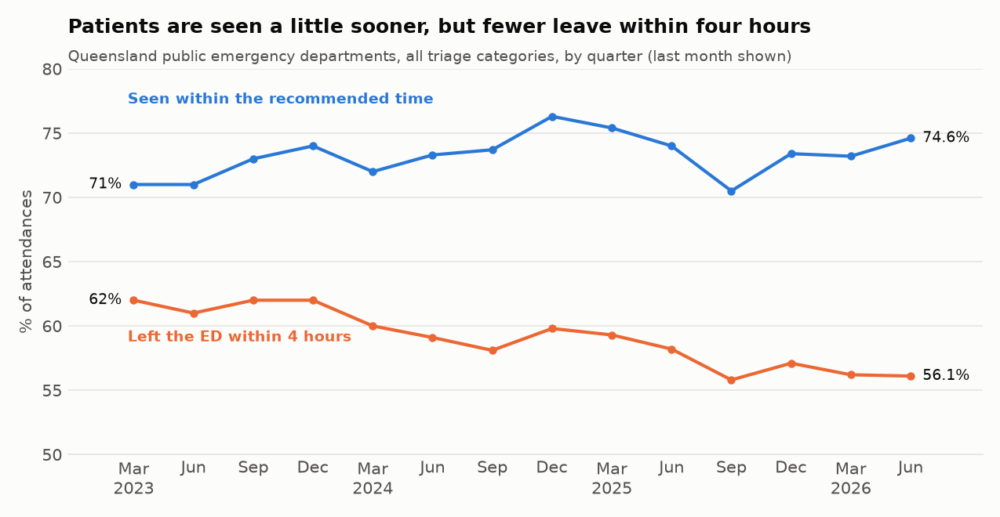
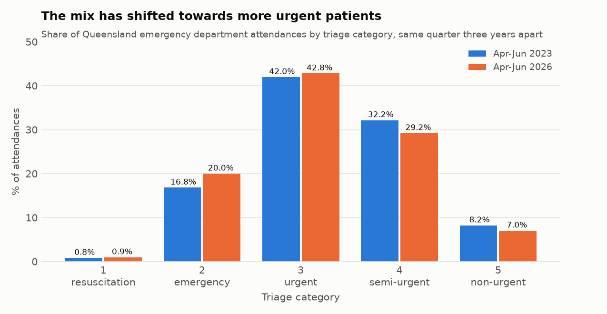
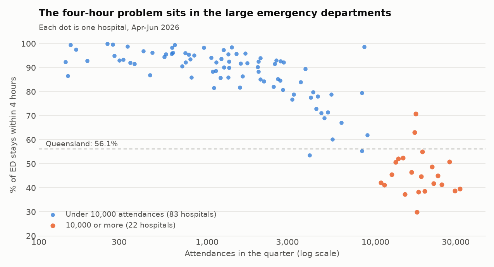

# Source profile: Queensland emergency departments, quarterly

*Generated by `scripts/profile_source.py` from the snapshot in `data/`. Do not edit by hand.*

Source: Queensland Health, [Emergency departments - quarterly data](https://www.data.qld.gov.au/dataset/emergency-departments-quarterly-data), CC BY 4.0. One row per hospital, quarter and triage category. A quarter is named by its last month, so `2026-06` is Apr-Jun 2026.

## 1. What is in the snapshot

- **14 quarters**, Jan-Mar 2023 to Apr-Jun 2026; **8,826 rows**.
- **104 hospitals** in every quarter, plus one "Queensland" total row per triage category. **Mater Springfield** first reports in Apr-Jun 2026, which makes 105.
- Six rows per hospital and quarter: triage categories 1 to 5 and `ALL`.
- **2,406,005 attendances** in the four quarters to Apr-Jun 2026, against 2,353,735 in the four quarters to Apr-Jun 2024 (+2.2% over two years).

## 2. The state picture

Same quarter, three years apart (Apr-Jun 2023 was published in whole percentages):

| Measure (all triage categories) | Apr-Jun 2023 | Apr-Jun 2026 |
| --- | ---: | ---: |
| Attendances | 584,431 | 593,177 |
| Seen within the clinically recommended time | 71% | 74.6% |
| Median wait to treatment (minutes) | 17 | 14 |
| ED stay within 4 hours | 61% | 56.1% |
| Admitted from the ED | 28% | 29.0% |
| Admissions to hospital within 4 hours | 37% | 31.3% |
| Did not wait for treatment | 3.2% | 2.9% |
| Left after treatment started | 4.4% | 5.0% |

The last two rows are worked out from the published counts, so both columns have one decimal place. "Admissions to hospital within 4 hours" is the source's wording; it is read here as the share of admitted patients whose ED stay was within 4 hours.

- **The front door got a little faster.** Patients seen on time went from 71% to 74.6%, and the median wait from 17 to 14 minutes.
- **The back door got slower.** Stays within 4 hours fell from 61% to 56.1%. For patients who are admitted it fell from 37% to 31.3%: on that reading, about two in three admitted patients now spend more than 4 hours in the ED.
- **Attendances barely moved** (+1.5% on the same quarter three years earlier), so volume alone does not explain the longer stays.

### By triage category, Apr-Jun 2026

| Triage | Attendances | Share | Seen on time | Median wait (min) | Admitted | Stay within 4 h |
| --- | ---: | ---: | ---: | ---: | ---: | ---: |
| 1 | 5,602 | 0.9% | 99.9% | 0 | 73.1% | 40.9% |
| 2 | 118,616 | 20.0% | 72.1% | 7 | 47.6% | 41.3% |
| 3 | 253,936 | 42.8% | 68.8% | 17 | 34.7% | 46.7% |
| 4 | 173,346 | 29.2% | 80.2% | 20 | 12.4% | 72.2% |
| 5 | 41,677 | 7.0% | 95.0% | 16 | 3.8% | 90.5% |
| ALL | 593,177 | 100.0% | 74.6% | 14 | 29.0% | 56.1% |

The mix is getting more urgent. Category 2 went from 16.8% of attendances in Apr-Jun 2023 to 20.0% in Apr-Jun 2026; categories 4 and 5 together went from 40.4% to 36.2%. More urgent patients are admitted more often and stay longer, so part of the fall in the 4-hour figure is mix. Part 2 separates the two.

## 3. A few large hospitals carry the state figure

In Apr-Jun 2026, **22 of 105 hospitals** had 10,000 or more attendances. They handled **70.2%** of all attendances; the largest 14 alone handled just over half.

| Attendances in the quarter | Hospitals | Attendances | Share | Stay within 4 h | median hospital | lowest | highest |
| --- | ---: | ---: | ---: | ---: | ---: | ---: | ---: |
| 10,000 or more | 22 | 416,132 | 70.2% | 45.7% | 44.9% | 29.9% | 70.8% |
| under 10,000 | 83 | 177,045 | 29.8% | 80.6% | 91.7% | 53.6% | 100.0% |

Weighted by attendances, 45.7% of stays at the large hospitals were within 4 hours, against 80.6% at the rest. The state's 56.1% is therefore mostly a statement about 22 hospitals, and it is far from the typical one: the median across all 105 is 86.9%. The same holds for patients seen on time (74.6% for the state, 90.9% for the median hospital).

The five largest:

| Hospital | Attendances | Seen on time | Median wait (min) | Stay within 4 h |
| --- | ---: | ---: | ---: | ---: |
| Gold Coast University | 31,831 | 73.9% | 11 | 39.5% |
| Logan | 29,727 | 67.2% | 13 | 38.8% |
| Prince Charles | 27,627 | 61.4% | 22 | 50.8% |
| Sunshine Coast University | 24,756 | 73.9% | 11 | 41.4% |
| Townsville | 23,449 | 74.5% | 15 | 45.0% |

## 4. Checks on the source

- **Triage categories add up.** Categories 1 to 5 sum to the `ALL` row in 1,471 of 1,471 hospital-quarters (state rows included).
- **Hospitals add up to the state.** Attendances, did-not-wait counts and left-after-treatment counts summed over hospitals equal the Queensland row in 14 of 14 quarters (mismatches: 0, 0, 0).
- **Percentages match their counts.** "Did not wait" (7,859 rows) and "left after treatment" (7,985 rows) equal count ÷ attendances to the published rounding, with 0 and 0 exceptions.
- **State rates are attendance-weighted.** The state "seen on time" and "stay within 4 hours" figures are within 0.44 and 0.48 points of the attendance-weighted mean of hospital figures in every quarter (hospital figures are rounded, so a small gap is expected).
- **"Variation in attendances" is the change on the same quarter a year earlier.** Recomputed from this snapshot for 6,157 rows: 6,115 agree to the published rounding. The 42 that do not are all in two quarters, Jan-Mar 2024 and Oct-Dec 2025, at 18 hospitals. Their all-categories rows:

| Hospital | Quarter | Attendances | A year earlier (snapshot) | Change, recomputed | Change, published | Year-earlier figure the published change implies |
| --- | ---: | ---: | ---: | ---: | ---: | ---: |
| Blackwater | Jan-Mar 2024 | 1,762 | 1,380 | +27.7% | +27% | 1,387 |
| Cherbourg | Jan-Mar 2024 | 1,701 | 1,642 | +3.6% | +2% | 1,668 |
| Cunnamulla | Jan-Mar 2024 | 312 | 476 | -34.5% | -35% | 480 |
| Mount Morgan | Jan-Mar 2024 | 919 | 751 | +22.4% | +21% | 760 |
| Mundubbera MPHS | Jan-Mar 2024 | 201 | 180 | +11.7% | +11% | 181 |
| Nambour | Jan-Mar 2024 | 16,816 | 15,212 | +10.5% | +10% | 15,287 |
| Quilpie | Jan-Mar 2024 | 207 | 145 | +42.8% | +44% | 144 |
| Texas | Jan-Mar 2024 | 361 | 325 | +11.1% | +10% | 328 |
| Nambour | Oct-Dec 2025 | 18,115 | 14,849 | +22.0% | +5.0% | 17,252 |
| Queensland | Oct-Dec 2025 | 611,486 | 592,827 | +3.1% | +2.7% | 595,410 |

Either the year-earlier figure was revised somewhere this snapshot does not show, or the published change is wrong. The snapshot cannot tell which. Most gaps are a point or two. The exception is Nambour in Oct-Dec 2025, and the Queensland row for that quarter is out by a similar number of attendances.

## 5. Quirks the loader handles

- **Names drift.** 105 of 106 facility codes (the state row included) appear under more than one name (for example "Ipswich Hospital", then "Ipswich"). The code is the key; `data/facility_names.csv` lists every spelling.
- **Columns drift.** The triage column is `Triage Category` in some quarters and `Triage_Category` in others, its all-categories value is `All` in one quarter and `ALL` elsewhere, and five quarters carry an extra `Median Wait Traffic Light` column (dropped).
- **Precision changes.** Percentages are whole numbers in the 5 quarters to Jan-Mar 2024 and have one decimal place from Apr-Jun 2024.
- **Four spellings of "missing".** `-`, `NULL`, an empty string and a null all become empty cells.

### Empty cells by measure

| Measure | Empty | Row has no attendances | Row has attendances | Quarters affected (rows with attendances) |
| --- | ---: | ---: | ---: | ---: |
| attendances_change_pct | 216 | 97 | 119 | 14 |
| seen_on_time_pct | 199 | 199 | 0 | 0 |
| median_wait_min | 132 | 132 | 0 | 0 |
| did_not_wait_pct | 967 | 199 | 768 | 4 |
| left_after_treatment_pct | 841 | 199 | 642 | 4 |
| admitted_pct | 327 | 199 | 128 | 4 |
| admitted_within_4h_pct | 735 | 199 | 536 | 14 |
| stay_within_4h_pct | 212 | 199 | 13 | 4 |

- 199 rows have no attendances at all (192 of them are triage category 1). Their rates are empty, as they should be.
- In 4 quarters (Apr-Jun 2023 to Jan-Mar 2024) a **zero is published as `-`**: 768 of 769 rows with attendances and nobody who left without waiting have an empty percentage. In the other 10 quarters all such rows show 0.
- "Admitted within 4 hours" is empty in 536 rows that have attendances. In 506 of them nobody was admitted (or the admitted share is itself a `-`), so the measure has no base.

## 6. Rules for the rest of the project

1. **Use the facility code, not the name.**
2. **Work out "did not wait" and "left after treatment" from the counts**, not the published percentages: the counts are complete in every quarter and are not rounded.
3. **Mind the rounding break.** Up to Jan-Mar 2024 a published percentage can be off by up to 0.5 points, so a change of under a point across the break is not a finding.
4. **Compare like quarters.** Use the same quarter a year apart, or four-quarter totals, not neighbouring quarters.
5. **Do not average hospitals to describe the state.** The plain average of hospital 4-hour figures in Apr-Jun 2026 is 79.2%; the state figure is 56.1%. Weight by attendances, or compare hospitals within a size group.
6. **Compare within a triage category where possible.** The all-categories figures move when the mix moves.
7. **Where the published change and the snapshot disagree, flag the hospital instead of picking a side.** Growth figures for those hospital-quarters are not reliable.
8. **An empty "admitted within 4 hours" usually means nobody was admitted**, not a bad result.
